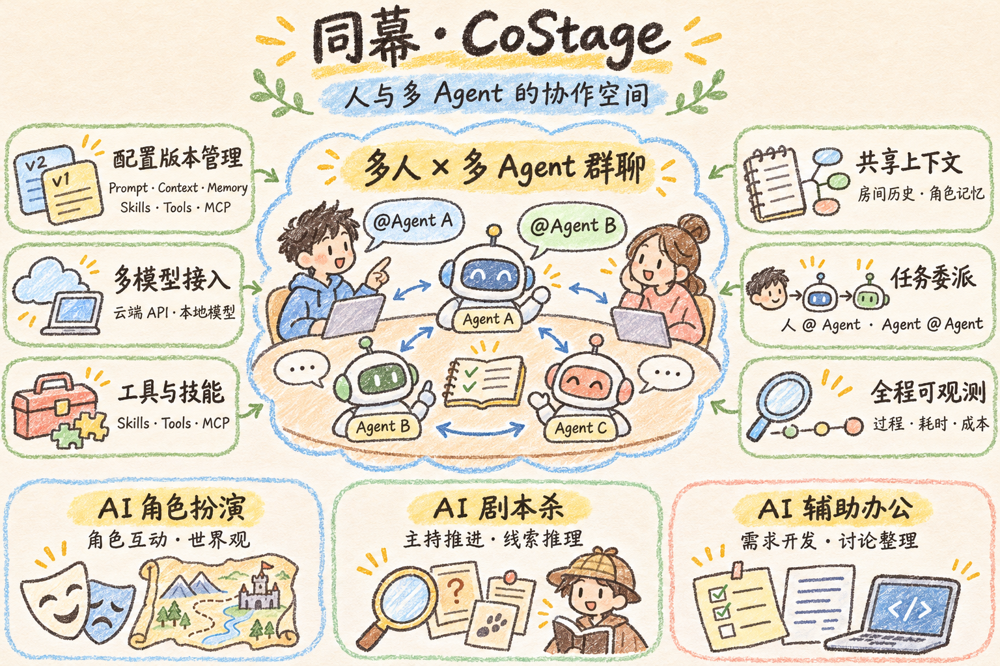

# 同幕 · CoStage

**人与多 Agent 的协作空间。**  
A shared workspace for people and AI agents.

CoStage 让人和多个 Agent 在同一房间协作：人可以 @ Agent 发起任务，Agent 可以委派其他 Agent，并在授权范围内共享上下文。产品面向 AI 角色扮演、剧本杀和辅助办公，支持 Agent 配置版本管理、多模型接入与运行过程观测。

当前处于系统设计阶段，仓库包含设计文档和调研资料，尚未包含产品实现。
