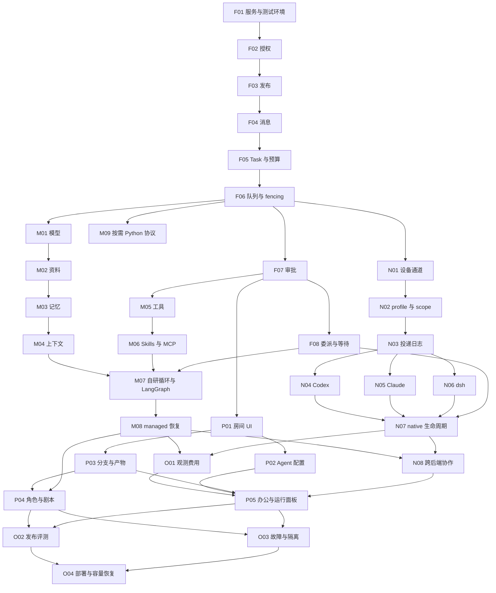

# CoStage 开发任务总览 Implementation Plan

> **For agentic workers:** REQUIRED SUB-SKILL: Use superpowers:subagent-driven-development (recommended) or superpowers:executing-plans to implement this plan task-by-task. Steps use checkbox (`- [ ]`) syntax for tracking.

**Goal:** 把 v5 设计变成有接口、有依赖、有独立验收的开发任务。

**Architecture:** 先交付业务控制面，再分别实现 managed Harness 与 native Connector，最后接入三个产品场景与运营验收。状态和恢复所有者沿用 v5，具体代码组织采用模块化单体与必要的执行进程。

**Tech Stack:** TypeScript、Node.js 24 LTS、React、Fastify、LangGraph JS、PostgreSQL/pgvector、对象存储、Vitest、Playwright。Python 只作为按需服务。

**Spec:** [系统设计 v5](../../system-design.md)、[原生接入 v5](../../native-agent-integration.md)。执行前同时阅读[计划总入口](2026-11-11-costage.md)，其中定义公共类型、测试约定和依赖图。

## Global Constraints

- TypeScript 主栈；Python 按需独立服务，TS 业务层拥有任务、授权和平台记忆事实。
- 邀请制、多团队独立空间；所有业务表带 `tenant_id`，授权身份来自可信登录。
- 默认每房间 20 名参与者、8 个 Agent、4 个同时执行片段。
- 默认最大委派深度 3、每次扇出 3、每个 Task 最多 12 个 Run 与 24 次模型调用，所有重试共用预算。
- 普通消息不触发执行；结构化 @ 创建 Task，Agent 委派只能通过 `delegate_task`。
- managed 使用自研循环与策略 + LangGraph JS；native 由原生运行时恢复，同一 Run 不跨后端恢复。
- 个人原生模式默认仅本人调用，结果私密后批准分享；严格剧本使用 managed。
- 仅文本与文件；不加入音视频、公开技能市场或跨空间 Agent 网络。

## Review Focus

- F02/M04/O03：当前权限被撤销后，旧 grant、摘要、快照和晚到结果都不能继续公开。
- F08/M08：子结果先到或 checkpoint 落后于业务提交，恢复不得丢失或重复动作。
- N03/N07：原生 prompt 的回执丢失与取消未确认，不能盲重发或换设备执行。
- N02/N06：调用人变化与 runtime-wide 通知，不能串会话、记忆或私密输出。
- M01/O01/O04：重试、观测故障和容量测量，费用与通过结论必须有实际记录。

---

## 计划状态与阅读入口

本计划包含 **34 个任务、5 份子计划**。每个任务有创建/修改文件、Consumes/Produces 接口、前置依赖、失败测试、实现要求、验收命令和提交范围。当前只完成计划编写与一致性检查，尚未实现应用或执行产品测试。

设计基线是仓库 `main` 提交 `459a1f82a52888ec91ce0626ceb63f3b502168ca` 下的 v5。核对时仓库仅有 LICENSE、README、产品图片、两份设计文档与调研快照，共 6 个文件。下文的应用、测试与部署路径均为拟新增路径；Modify 表示修改前序任务已经创建的文件，届时以文件职责和接口定位，不预填不存在的行号。旧设计文档中的“只到设计为止”描述其当时交付范围，本计划记录用户此次授权的新阶段，不改写原始研究快照。

| 子计划 | 任务 | 独立验收成果 |
| --- | --- | --- |
| [基础平台](2026-11-11-costage-foundation.md) | F01–F08 | 权限、消息、发布、任务、审批、队列与委派能在桩执行器上运行 |
| [managed 运行时](2026-11-11-costage-managed.md) | M01–M09 | 自研循环能调用模型/工具，管理输入与记忆，并在故障后恢复 |
| [原生 Agent 接入](2026-11-11-costage-native.md) | N01–N08 | Connector 驱动 Codex、Claude Code、dsh，隔离会话并正确处理未知投递 |
| [产品场景](2026-11-11-costage-experience.md) | P01–P05 | 多人聊天、Agent 配置、分支产物、角色/剧本与办公流程可使用 |
| [运行与验收](2026-11-11-costage-verification.md) | O01–O04 | 观测、评测、隔离、部署和容量/备份恢复有可检查证据 |

建议先交付 F01–F08 的业务基础和 M01–M08 的 managed 闭环，再完成 native 接入与跨后端协作。开发时允许依赖已满足的任务分别推进；任务表是依赖的权威记录，图只用于把握主要顺序。每个任务完成自己的测试周期再进入后继任务，不把所有接口先写成空壳后集中联调。

## 代码组织与语言

| 路径 | 职责与边界 |
| --- | --- |
| `apps/web/src` | React + TypeScript，按 rooms/agents/tasks/approvals/artifacts/scenes/runs 分功能 |
| `apps/api/src` | Fastify HTTP、可信登录、SSE、参数与错误映射，调用领域服务 |
| `apps/worker/src` | PostgreSQL 作业领取、Runtime Router、执行片段调度 |
| `apps/connector-gateway/src` | 认证 WSS、命令投递、设备事件接收，与浏览器 SSE 分离 |
| `apps/connector/src` | 设备 CLI、凭据、SQLite 命令日志、原生会话和工作目录占用 |
| `apps/tool-runner/src` | 受限工具执行协议，运行在独立隔离环境 |
| `packages/contracts/src` | TS schema、类型和导出的 JSON Schema；边界按 schema_version 拒绝不兼容输入 |
| `packages/core/src` | tenant/rooms/releases/tasks/delegation/资料/记忆/产物/场景等业务事实 |
| `packages/runtime-managed/src` | 自研模型/上下文/循环/工具策略以及 LangGraph JS 适配 |
| `packages/runtime-native/src` | 设备能力、profile、native 会话编排与三种提供者适配 |
| `packages/infra/src`、`packages/infra/migrations` | pg 显式 SQL 事务、对象存储、观测和领域增量迁移 |
| `packages/testkit`、`tests` | 独立数据库、录制协议、确定性外部桩、集成/浏览器/故障/负载验收 |
| `deploy` | 独立进程镜像、配置、隔离与恢复说明 |
| `services/<capability>` | 仅出现明确 Python 专属需求后创建；当前只交付 M09 的跨语言协议 |

采用 pnpm workspace。数据库选 `pg` + SQL 迁移，便于在同一事务中明确处理 tenant、fencing、账本和 Outbox。契约用 Zod 定义并导出 JSON Schema，TS 通过 `z.infer` 派生类型，不同时手写两套边界对象；Python 将来消费导出的 schema。设备日志使用 SQLite，云端主队列使用 PostgreSQL，首版不增加 Redis 或 Temporal。

Node.js 选择 **24 LTS**，理由是本项目更需要 SDK、原生依赖和分发兼容性，暂不追逐新主版本。24 与 26 在本次核对时均为 LTS；F01 固定实际补丁版本和 pnpm 版本，M07/N04–N06 固定框架/提供者兼容组合。[Node.js 官方发布表](https://nodejs.org/en/about/previous-releases)

## 公共契约

以下是接口设计，供任务之间对齐，不是本次新增的产品代码。JSON 使用 camelCase，SQL 使用 snake_case，转换只在持久层完成。时间为 UTC ISO 8601，ID 为不透明字符串，费用使用整数微美元的十进制字符串，避免浮点结算。函数签名表示已装配依赖的服务方法；构造器和连接池不逐项重复。

### F01 的公共类型

```ts
type Id = string;
type Revision = string;
type Digest = string;
type ISODate = string;
type JsonValue = null | boolean | number | string | JsonValue[] | {[key:string]:JsonValue};
type JsonObject = {[key:string]:JsonValue};
type Tx = import("pg").PoolClient;
type BlobRef = {key: string; digest: Digest; mediaType: string; size: number};
type RevisionRef = {tenantId: Id; id: Id; revision: Revision; digest: Digest; kind: string};
type Audience = {kind: "room" | "members" | "role" | "task" | "host" | "owner"; subjectIds: Id[]};
type Actor = {tenantId: Id; userId: Id; principalId: Id; principalKind: "user" | "service"};
type RunRef = {tenantId: Id; taskId: Id; runId: Id};
type Lease = RunRef & {workerId: Id; epoch: number; expiresAt: ISODate};
type SystemJobRef = {tenantId:Id; jobId:Id; budgetId:Id; grantId:Id};
type SystemLease = SystemJobRef & {workerId:Id; epoch:number; expiresAt:ISODate};
type ActionLease = Lease | SystemLease;
```

Audience 表示输出目标，来源资源的 ACL 另存；输出目标不赋予读取来源的权限。Subject ID 的含义由 kind 决定，不能用显示昵称代替。RevisionRef 的 kind 必须在所属领域的 schema 中枚举，不接受客户端任意资源种类。

### F02 的授权对象

```ts
type WorkspaceRole = "admin" | "author" | "member";
type AccessRequest = {
  action: "read" | "edit" | "delete" | "model" | "tool" | "delegate" | "publish" | "invite" | "admin";
  resourceIds: Id[]; audience: Audience; credentialSubject?: Id;
  dataGrantIds?: Id[]; delegateTo?: Id[];
};
type Grant = {
  id: Id; revision: Revision; tenantId: Id; requester: Id; executionPrincipal: Id;
  credentialSubject: Id; allowedResourceIds: Id[]; allowedToolIds: Id[];
  allowedDelegateIds: Id[]; audience: Audience; expiresAt: ISODate;
};
```

F03 的 `ResourceKind` 为 prompt、context_policy、memory_policy、skill、tool、mcp、model_profile、loop_policy、runtime_profile、scene 的枚举；各 kind 校验自己的 schema 与创建权限。

房间管理员是 Room/Participant 上的角色，与 WorkspaceRole 分开。任何交集为空、当前权限已撤销、凭据主体不匹配或结果受众超范围都拒绝；资源为空不能解释为全部资源。

### F03–F06 的消息、任务与运行

```ts
type RuntimeReleaseBinding =
  | {kind:"managed"; loopRevision:RevisionRef; modelProfileRevision:RevisionRef}
  | {kind:"native"; deviceId:Id; profileRevision:RevisionRef};
type ManagedBinding = {
  kind:"managed"; adapterRevision:Revision; threadId:Id; entrypointRevision:Revision;
  frameworkVersions:Record<string,string>;
};
type NativeBinding = {
  kind:"native"; adapterRevision:Revision; deviceId:Id; profileRevision:RevisionRef;
  runtimeVersion:string; sessionScopeDigest:Digest; nativeSessionId?:Id;
};
type RuntimeBinding = ManagedBinding | NativeBinding;
type MessageInput = {
  roomId:Id; branchId:Id; text:string; mentions:{instanceId:Id}[];
  fileRefs:RevisionRef[]; audience:Audience; idempotencyKey:string; replyTo?:Id;
};
type RoomEvent = {
  tenantId:Id; roomId:Id; branchId:Id; eventId:Id; seq:number; type:string;
  senderId:Id; payloadRef:RevisionRef; acl:Audience; causationId?:Id; replyTo?:Id;
};
type StreamEvent = {kind:"committed"; event:RoomEvent} |
  {kind:"delta"; runId:Id; attempt:number; chunkSeq:number; text:string; audience:Audience};
type TaskInput = {
  branchId:Id; triggerEventId?:Id; rootInstanceIds:Id[]; instructions:RevisionRef;
  audience:Audience; deadline:ISODate; idempotencyKey:string; mode:"mention"|"scene"|"evaluation";
};
type RunStatus = "queued"|"running"|"waiting_children"|"waiting_approval"|"blocked"|
  "succeeded"|"failed"|"cancelled"|"budget_exhausted";
type TaskStatus = "queued"|"running"|"waiting"|"blocked"|"succeeded"|"partial"|
  "failed"|"cancelled"|"budget_exhausted";
type ResolvedRunConfig = {baseProfileRef:RevisionRef; schemaVersion:string; parameters:JsonObject; digest:Digest};
type RunSpec = RunRef & {
  roomId:Id; branchId:Id; baseSeq:number; parentRunId?:Id; agentInstanceId:Id;
  releaseId:Id; releaseMap:Record<Id,Id>; sceneRelease?:RevisionRef; grant:Grant;
  deadline:ISODate; resolvedConfig:ResolvedRunConfig; binding:RuntimeBinding; status:RunStatus;
};
type RunOutcome = {status:"succeeded"|"failed"|"cancelled"|"budget_exhausted";
  artifactRefs:RevisionRef[]; reason?:string; warnings:string[]};
type UsageReservation = {modelRequests:number; inputTokens?:number; outputTokens?:number; costMicrousd?:string};
type UsageAmount = {inputTokens?:number; outputTokens?:number; costMicrousd?:string;
  gpuMs?:number; completeness:"actual"|"estimated"|"unknown"};
```

SystemJob 用于上传文件后的索引和资料清理，使用同一 PostgreSQL 调度基础及独立系统预算；它不是 Agent Run。模型 embedding 接口接收 ActionLease，区分任务预算与系统预算，不能落成不可见的免费调用。

Task 记录总预算与截止时间，Run 引用同一个 Task，不复制可重置的子预算。每次真实模型 attempt 的预留键固定为 `modelCallId + attemptNo`，同 attempt 重放不重复预留，新网络 attempt 消耗一次模型次数。未知 native token 不转成 0，也不承诺硬 token 上限。

evaluation 模式仅由 O02 已授权的评测入口创建，并强制模拟工具策略，普通消息入口不得自选此模式。

native_session_id 在原生回执首次确认后写入一次，除此之外不改变已接受 Run 的执行与恢复绑定。native 的连接/投递/执行状态不复用 RunStatus；它们的定义在下一节。

### F07–F08 的审批与等待

审批必须按 kind 使用不同 schema。公共字段是 operationId、subjectId、audience、expiresAt。`platform_tool` 额外固定 toolRevision 与 argsDigest；`native_action` 固定 deviceId、sessionId、nativeRequestId、actionDigest；`result_share` 固定 resultRevision。`Approval` 在此基础上增加 id、status（pending/approved/denied/expired）、decidedBy 和 decidedAt，后两项仅在决策后存在。

```ts
type DelegateInput = {
  operationId:Id; targetInstanceId:Id; instruction:string; materialRefs:RevisionRef[];
  audience:Audience; wait:boolean; required:boolean;
};
type WaitEvidence =
  | {kind:"managed"; checkpointId:Id; interruptId:Id; durableAt:ISODate}
  | {kind:"native"; sessionId:Id; nativeReceiptId:Id; capabilityRevision:Revision;
     mode:"persistent_wait"|"serial_continuation"};
type ResumeEnvelope = RunRef & {
  id:Id; waitId:Id; generation:number; resultRefs:RevisionRef[]; reason:string;
};
```

业务等待先注册，具体后端提交可核实的等待证据后才 ready。`takeResume` 不等于消费，只有接纳阶段持久化后 `ackResume` 才确认。required 与 wait 是不同字段，不能把不等待等同于可忽略失败。

### M01–M06 的模型、上下文与工具

| 类型及归属 | 必需字段与约束 |
| --- | --- |
| F03 `ReleaseDraft` / `AgentRelease` | draft 固定 prompt/contextPolicy/memoryPolicy/skills/tools/mcp/modelProfile/loopPolicy/runtimeBinding；所有内容依赖均为 RevisionRef。发布增加 releaseId、manifestDigest、status；状态遵循 draft→validated→staged→published→retired |
| F03 `ReleaseDiff` | `{changes: {path: string; before?: Digest; after?: Digest}[]}`，另带 base/target releaseId |
| M01 `ModelProfile` | provider、model、endpointRef、credentialRef、参数 schema、outputLimit、contextWindow、timeouts、rateLimits、capabilities、dataResidency、fallbackRefs；vendor 扩展字段须 schema 校验 |
| M01 `ModelCall` / `ModelResponse` | 与 M01 接口定义一致；toolCalls 每项有稳定 callId、toolRevision 与已校验 args。响应包含实际 provider/model/fingerprint 和逐 attempt 记录 |
| M01 `SnapshotDraft` / `ModelInputSnapshot` | draft 为 modelCallId、grantRevision、sourceRefs、summaryRefs、memoryRefs、skillRefs、toolSchemaRefs、resolvedConfig、encryptedBodyRef、requestDigest；snapshot 增加 id、revision、createdAt。M01 的 store 持有存储，M04 负责组装 |
| M01 `ModelStreamEvent` | runId、modelCallId、attempt、chunkSeq、kind（delta/attempt_failed/completed）、可选 text/responseRef。完成事件指向已持久响应 |
| M03 `MemoryRevision` | RevisionRef 加 scope、textRef、sources、audience、validFrom/validTo、confidence、extractorRevision、replaces；MemoryCandidate 是写入上述字段所需的未分配 revision 输入 |
| M04 `SummaryRevision` | RevisionRef 加 coveredEventRange、sourceRefs/sourceACL、policyRevision、modelRevision、contentRef；不得跨不同权限来源合成可公开摘要 |
| M05 `ToolRequest` / `ToolIntent` / `ToolOutcome` | 见 M05；unknown 只表示需要对账，不是可重试失败。ToolIntent 保存冻结参数、工具版本和 operationId |
| M06 `SkillContent` | metadata、可选 instructions、references/scripts/assets 的固定 RevisionRef；metadata 模式不读取全部正文 |
| M06 `McpBindingRevision` | protocolVersion、sdkVersion、adapterRevision、extensions、implementationRef、endpointRef、catalogRevision、schemaDigest、credentialRef、allowedTools、timeout/outbound policy；协议、目录与实现版本分开 |
| M07 `LoopState` / `LoopAction` | LoopState 为 runRef、iteration、acceptedDeltaRefs、已提交步骤/工具/委派结果引用；LoopAction 按 kind 为 model、tool（ToolRequest）、delegate（DelegateInput）、wait（waitId）或 finish（RunOutcome） |
| M07 `ManagedPosition` | not_started；interrupted（waitId/checkpointId/interruptId）；running；completed（outcomeRef）。只由框架状态和已提交业务事实判定 |
| M09 `CapabilityRequest` / `CapabilityJob` | 见 M09；job 状态与取消确认独立，输出只回不可变引用 |

M03 的 `MemoryScope` 为 `{kind: "instance"; roomId: Id; branchId: Id; instanceId: Id}` 或 `{kind: "personal" | "project" | "team"; subjectId: Id}`，后者须额外授权；`MemoryCandidate` 的 textRef 在候选阶段可由待存储正文替代，提交后统一转为不可变引用。

### N01–N07 的设备与原生协议

```ts
type CapabilityState = "supported"|"unsupported"|"unknown";
type CapabilitySnapshot = {
  revision:Revision; provider:"codex"|"claude"|"dsh"; runtimeVersion:string;
  schemaVersion:string; expiresAt:ISODate; parameterSchema:JsonObject;
  features:Record<string,{state:CapabilityState; reason?:string}>;
  authorization:Record<string,"granted"|"denied">;
};
type SessionScope = {
  tenantId:Id; deviceOwner:Id; requester:Id; credentialSubject:Id; roomId:Id;
  branchId:Id; instanceId:Id; profileScope:Id; dataGrants:Id[]; audience:Audience;
};
type NativeLocator = {sessionId:Id; turnOrMessageId?:Id};
type NativeReceipt = NativeLocator & {receiptId:Id; acceptedAt:ISODate};
type NativeObservation = {
  locator:NativeLocator; connectionState:"online"|"offline";
  deliveryState:"accepted"|"dispatch_intent"|"receipt"|"delivery_unknown";
  executionState:"queued"|"running"|"waiting"|"completed"|"quiescent"|"unknown";
  requiredDescendantsQuiescent:boolean; resultRefs:RevisionRef[];
  evidenceRefs:RevisionRef[]; coverage:Record<string,CapabilityState>;
};
type ContextEnvelope = {
  runRef:RunRef; cutoffSeq:number; inputRefs:RevisionRef[]; audience:Audience;
  grantRevision:Revision; digest:Digest;
};
type NativeStart = {
  commandId:Id; runRef:RunRef; scope:SessionScope; profileRef:RevisionRef;
  envelope:ContextEnvelope; deadline:ISODate; locator?:NativeLocator;
};
type NativeDecision = {nativeRequestId:Id; decision:"approve"|"deny"; actionDigest:Digest};
interface ProviderPort {
  probe():Promise<CapabilitySnapshot>;
  start(input:NativeStart):Promise<NativeReceipt>;
  query(locator:NativeLocator):Promise<NativeObservation>;
  interrupt(locator:NativeLocator):Promise<NativeObservation>;
  decide(locator:NativeLocator, decision:NativeDecision):Promise<void>;
  events(locator:NativeLocator):AsyncIterable<NativeEvent>;
}
```

| 类型及归属 | 必需字段与约束 |
| --- | --- |
| N01 `NativeCommand` | commandId、runRef、deviceId、profileRef、inputDigest、grantRevision、leaseEpoch、deadline，加按 kind 的 payload。start/continue 使用固定 ContextEnvelope 引用；query/interrupt 使用 NativeLocator；approve 使用 NativeDecision；cleanup 使用获准资源引用。payload 不是任意 RPC |
| N01 `NativeEvent` | eventId、source、deviceId、seq、commandId、sessionId、parentSessionId、kind、evidenceRef、coverage。不存在的关联字段可省略，不伪造 ID；provider-specific payload 须先本地过滤/脱敏 |
| N02 `LocalRegistration` | deviceId、executableId、workdirId、profileRef、approvedConfigSources；实际路径只从本地注册表解析，不从云端命令接受自由字符串 |
| N02 `RuntimeProfileDraft` / `RuntimeProfileRevision` | provider、registration、模型参数、configSources、memoryPolicy、allowedTool/MCPRefs、mode（personal/controlled）、allowedRequesters、audience、isolationEvidenceRef。Revision 增加 id/revision/digest/capabilityRevision |
| N03 `CommandRecord` | NativeCommand、deliveryState、nativeReceipt、lastEventSeq，与原始输入 digest 绑定；事件与命令在 SQLite 中持久化 |
| N08 `BridgeArgs` / `BridgeResult` | 见 N08；method 决定 schema，不允许把 delegate 参数作为 status/result 的任意查询 |

NativeCommand、NativeEvent、NativeLocator 和 NativeDecision 由 N01 的 connector.ts 定义，其余原生类型与 ProviderPort 由 N02 定义，N01 不反向依赖 N02。

`query` 找不到可靠关联证据时返回 unknown，不猜测没执行。native 费用/输入缺失用 coverage 和 unknown 展示；不填虚构的模型调用或零费用。

### P/O 的场景与观测

P01 的 `RoomView`、P04 的 `SceneDraft/WorldAction` 和 O02 的 `EvaluationReport` 在所属任务定义 schema。WorldAction 只能是固定 SceneRelease 声明的动作种类和字段。P05 的 `RunView` 是 Task/Run、O01 trace、N07 会话信息的授权只读投影，不持有另一个可写状态机。

O01 `TraceRecord` 含 eventId、kind、timestamp、tenantId、roomId、branchId、taskId、runId，以及可选 parentRunId/releaseId/stepId/operationId/modelCallId/snapshotId/runtimeBindingId/deviceId/commandId/nativeTurnId；负载只含版本、引用、耗时、token 变化、原因与 coverage。`RunTrace` 为经授权的 TraceRecord 列表和关联索引。`UsageReport` 包含已知费用、unknownCount、completeness（complete/partial）、实际/估算明细与 priceRevision；`CostEstimate` 为 costMicrousd、currency、priceRevision 与 actual/estimated/unknown。

O03 `IsolationRequirements` 是必须限制的文件、网络、配置、记忆、hook/MCP/子进程和审批能力集合；`IsolationEvidence` 为当前 OS/runtime/profile/策略 revision 下逐项探测的通过/失败与证据引用。O04 `CapacityReport` 至少含任务断言中的 messageCommitP95Ms、queueP95MsWithinQuota、chunkForwardP95Ms、workerRecoveryMaxMs、stopNewDispatchMaxMs，另附负载、硬件、版本、采样窗口和错误率。

## API 行为与测试约定

所有 HTTP 写接口都做身份校验、schema 校验和当前授权。异步接纳返回 202 与可查询 ID；幂等键同参数返回原结果，不同参数返回 409。版本冲突使用 409，权限不足使用 403，限流使用 429，不支持的能力/协议使用明确的 422 错误码，暂时离线则保持 queued/blocked 的业务状态。错误统一为 `{code, message, retryable, correlationId}`，不得把 unknown 写入标为可自动重试。

测试片段刻意只写测试名称和关键断言，省略 import 和夹具构造。每个 Step 1 的文字就是 Arrange 说明，代码里的 actor、lease、响应、计数器和状态必须由该说明对应的真实服务/协议桩产生，不能把期望常量直接赋给结果变量。新增测试文件须包含这些夹具和实际调用。集成测试使用真实 PostgreSQL；外部模型/工具/原生协议用确定性本地桩。fencing、checkpoint、RLS、队列和事务不能替换成内存假实现。

首个失败测试允许先提供正确签名的空导出，让测试进入目标行为；预期失败必须来自本任务尚未实现的行为，不接受语法错、数据库未启动或缺依赖充当红灯。每项任务通过自己的测试与 typecheck，再提交该项文件；lockfile 或工作区配置只有本任务确实改变依赖时才纳入。提交前实际审阅差异，不能把其他人的改动带入。

F01 的根 Vitest 配置与 typecheck 覆盖所有已存在工作区；P01 添加 Playwright 的实际 API/Web 启动配置；O04 才接完整 CI。所有新 SQL 迁移用独立命名文件，迁移号码只是本计划的固定分配，不按并行完成时间重编号。每个依赖任务先应用迁移，再用受 RLS 限制的应用连接运行测试。

## 依赖图



## 逐任务依赖表

| 任务 | 前置任务 | 入口 |
| --- | --- | --- |
| F01 可验证的服务与存储入口 | 无 | [任务详情](2026-11-11-costage-foundation.md#f01) |
| F02 空间身份与授权交集 | F01 | [任务详情](2026-11-11-costage-foundation.md#f02) |
| F03 不可变资源与 Agent 发布 | F02 | [任务详情](2026-11-11-costage-foundation.md#f03) |
| F04 房间消息与可恢复事件流 | F02、F03 | [任务详情](2026-11-11-costage-foundation.md#f04) |
| F05 请求到 Task 与统一预算 | F03、F04 | [任务详情](2026-11-11-costage-foundation.md#f05) |
| F06 公平队列与租约隔离 | F05 | [任务详情](2026-11-11-costage-foundation.md#f06) |
| F07 冻结动作的审批服务 | F05、F06 | [任务详情](2026-11-11-costage-foundation.md#f07) |
| F08 结构化委派与持久等待账本 | F05、F06、F07 | [任务详情](2026-11-11-costage-foundation.md#f08) |
| M01 模型网关与唯一重试责任 | F03、F05、F06 | [任务详情](2026-11-11-costage-managed.md#m01) |
| M02 文件修订与权限内检索 | M01 | [任务详情](2026-11-11-costage-managed.md#m02) |
| M03 可纠正与可删除的长期记忆 | F05、M02 | [任务详情](2026-11-11-costage-managed.md#m03) |
| M04 上下文压缩与逐次输入快照 | M01、M02、M03 | [任务详情](2026-11-11-costage-managed.md#m04) |
| M05 工具执行与副作用对账 | F06、F07、M01 | [任务详情](2026-11-11-costage-managed.md#m05) |
| M06 固定 Skill 包与 MCP 目录 | F03、M05 | [任务详情](2026-11-11-costage-managed.md#m06) |
| M07 自研循环与 LangGraph 持久阶段 | F06、F08、M04、M05、M06 | [任务详情](2026-11-11-costage-managed.md#m07) |
| M08 managed 等待与崩溃恢复 | M07 | [任务详情](2026-11-11-costage-managed.md#m08) |
| M09 按需 Python 能力服务契约 | F05、F06 | [任务详情](2026-11-11-costage-managed.md#m09) |
| N01 设备配对与受限双向通道 | F02、F06 | [任务详情](2026-11-11-costage-native.md#n01) |
| N02 能力配置与会话安全范围 | F03、N01 | [任务详情](2026-11-11-costage-native.md#n02) |
| N03 设备命令日志与单次投递 | N02 | [任务详情](2026-11-11-costage-native.md#n03) |
| N04 Codex App Server 适配 | N03 | [任务详情](2026-11-11-costage-native.md#n04) |
| N05 Claude Code SDK 适配 | N03 | [任务详情](2026-11-11-costage-native.md#n05) |
| N06 dsh 会话与通知隔离 | N03 | [任务详情](2026-11-11-costage-native.md#n06) |
| N07 原生恢复与私密结果发布 | F07、F08、N04、N05、N06 | [任务详情](2026-11-11-costage-native.md#n07) |
| N08 跨执行后端的协作桥 | F08、M08、N07、M06 | [任务详情](2026-11-11-costage-native.md#n08) |
| P01 多人房间与任务交互 | F04、F05、F07 | [任务详情](2026-11-11-costage-experience.md#p01) |
| P02 双入口 Agent 配置与版本界面 | P01、F03、M01、M06、N02 | [任务详情](2026-11-11-costage-experience.md#p02) |
| P03 分支与可协作产物 | F04、F05、M03、P01 | [任务详情](2026-11-11-costage-experience.md#p03) |
| P04 角色场景与严格剧本规则 | F03、F08、M08、P03 | [任务详情](2026-11-11-costage-experience.md#p04) |
| P05 办公协作与运行面板 | P02、P03、M08、N08、O01 | [任务详情](2026-11-11-costage-experience.md#p05) |
| O01 运行观测与可核对费用 | F05、M04、M08、N07 | [任务详情](2026-11-11-costage-verification.md#o01) |
| O02 版本评测与发布准入 | F03、P04、P05 | [任务详情](2026-11-11-costage-verification.md#o02) |
| O03 故障隔离与整链验收 | M08、N08、P04、P05 | [任务详情](2026-11-11-costage-verification.md#o03) |
| O04 部署与容量恢复演练 | O01、O02、O03 | [任务详情](2026-11-11-costage-verification.md#o04) |

## 设计覆盖与阶段验收

| v5 设计主题 | 实现与验收任务 |
| --- | --- |
| 设计目标、技术选型与邀请制范围 | F01、F02、M09、O04；TS 主栈、Python 可选边界保留 |
| Agent Prompt/Context/Memory/Skills/Tools/MCP 发布与版本 | F03、M03、M04、M06、P02、O02 |
| 模型 API、私网本地推理、自定义参数 | M01、M04、P02；本机 localhost 不伪装为云端可访问模型 |
| 多人多 Agent 消息、@、共享可见上下文 | F04、F05、P01、M04 |
| Agent 委派、循环上限、预算、公平调度 | F05、F06、F08、N08 |
| 自研策略/LangGraph 职责、状态归属与恢复 | M07、M08、F06、F08、O03 |
| 记忆纠错、分支、删除与撤权 | M02、M03、M04、P03、N07 |
| 工具副作用、审批、未知效果与 MCP 漂移 | F07、M05、M06、M08、O03 |
| Connector、Codex、Claude Code、dsh 和原生资源复用 | N01–N07、P02；真实设备证据与协议录制分列 |
| 原生个人/受控模式、分享、取消与未知投递 | N02、N03、N07、O03 |
| managed/native 跨后端协作与原生父后续 turn | F08、N08、P05 |
| 角色扮演与严格剧本杀 | P04、M04、O02、O03 |
| 需求开发与讨论梳理 | P03、P05、M05、O02；外部写入仍按授权和审批执行 |
| 可观测、费用、能力覆盖与发布评测 | O01、P05、O02 |
| 数据模型、接口、隔离、容量、部署与备份 | F01–F08、O03、O04 |
| Python 版本契约、幂等作业、取消与晚到结果 | M09；实际服务有具体业务需求后才实现 |
| 调研项目与许可 | 保留历史快照；引入依赖时由该任务记录版本/许可证，复用协议而不复制未审查的第三方源码 |

可演示的 managed 闭环需完成 F01–F08、M01–M08、P01，能 @ 一个 Agent、调用受限工具、生成结果并在 Worker 崩溃后恢复。双后端闭环再加 N01–N08、P02，能驱动本地提供者、批准分享并完成跨后端委派。完整首版继续完成 P03–P05、O01–O04，三个产品场景与隔离/容量/备份目标均有证据。

M09 的协议与桩测试属于设计边界验收，Python 服务部署不作为首版前置。受控原生模式、任意代码或浏览器工具只有对应隔离组合经过 O03 实测才启用；未验证能力在界面显示 unsupported/unknown，不以“计划完成”替代支持声明。Temporal、公开技能市场、开放注册和音视频仍不在范围内。

## 计划审阅与执行交接

编写后按 writing-plans 要求自行核对了设计覆盖、任务粒度、类型与方法名称、依赖环路、修改文件归属、五类重点故障及文档链接。详细自动检查结果保存在本地审阅记录，检查的是计划，不是产品功能通过报告。

建议后续采用 **Subagent-driven**：每项任务有独立实现者与审阅者，先检查接口和故障验收再进入后继任务。这份计划的主要风险集中在租约、等待桥接和原生命令账本，逐任务独立审阅有价值。另一种 **Native** 方式由当前会话依次实施，成本较低，但独立审阅集中在整批结束。

执行前请审阅任务与验收是否符合预期，再选择执行方式；本次不启动实现。上述交接遵循 [Superpowers writing-plans](https://github.com/obra/superpowers/blob/main/skills/writing-plans/SKILL.md) 的计划审阅流程。
