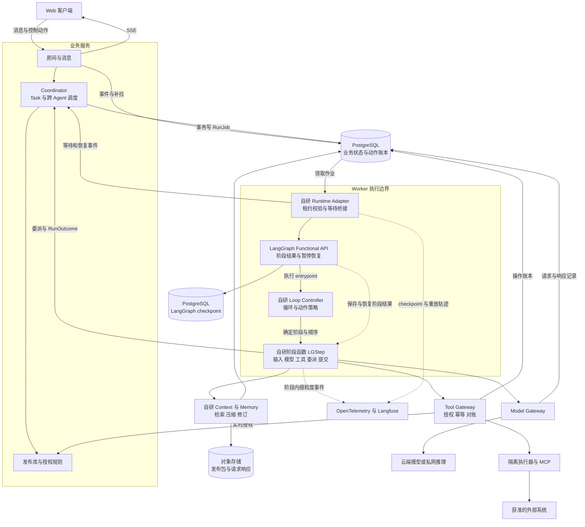
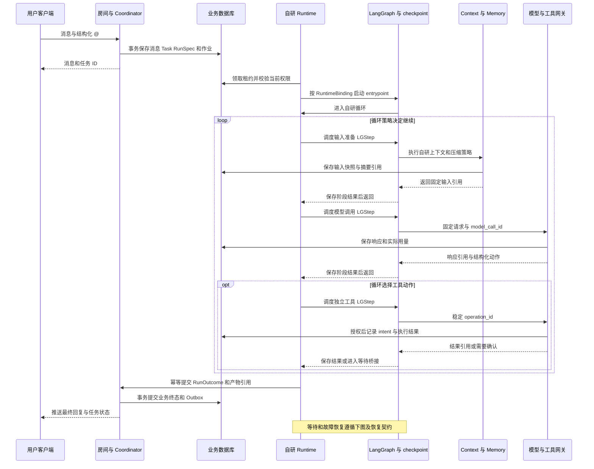
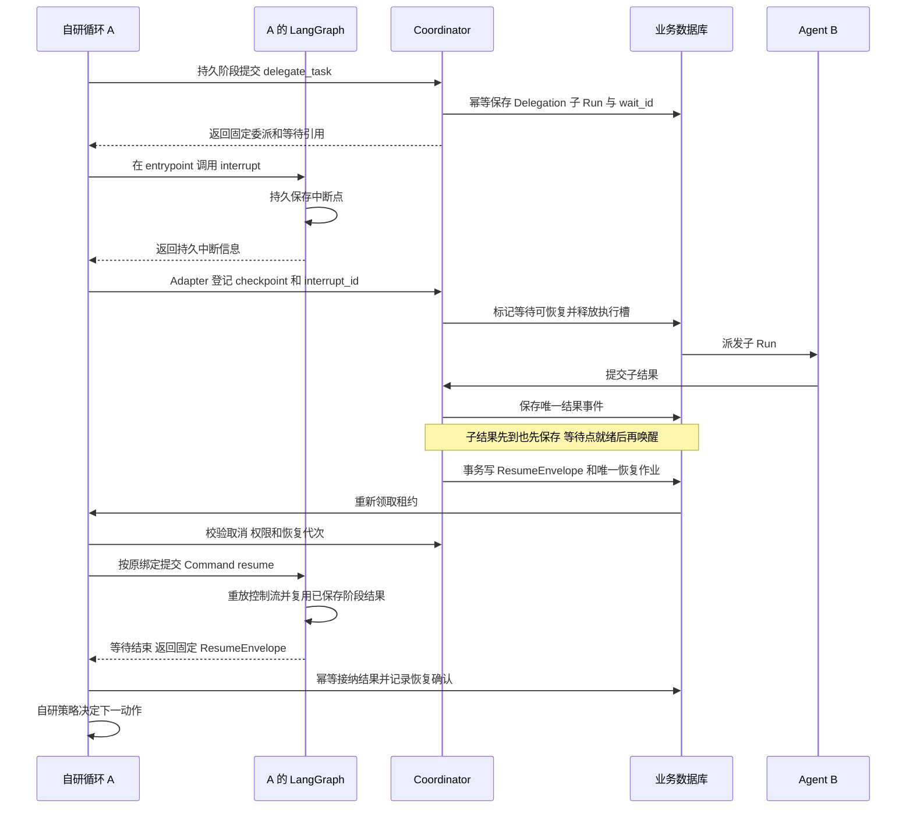

# 多 Agent 聊天服务系统设计

设计版本：v3。研究快照日期：2026-11-07，北京时间。已确认采用邀请制、多团队独立空间，以及“自研 Agent 循环和策略，LangGraph 负责持久执行”的架构。本文明确模块职责、状态归属和恢复边界，限定系统设计，不包含实施计划或产品代码。

**采用模块化单体：自建群聊、任务协调、Agent 循环与策略，复用 LangGraph Functional API 保存阶段结果、暂停和恢复。** 模型接入复用 LiteLLM，观测复用 OpenTelemetry 与 Langfuse。PostgreSQL 分别保存业务事实与框架 checkpoint，对象存储保存发布制品、文件和请求快照；API、Worker 与工具执行器分开运行。

系统支持多人、多 Agent 在同一个房间协作，并能解释每次执行的配置、输入、权限和结果。平台掌握 Agent 的控制逻辑、上下文压缩、记忆管理和事件规范；LangGraph 提供持久执行原语，通过 Runtime Adapter 接入。房间、任务和资源身份不依赖框架内部对象。

## 设计目标与边界

已确认的需求包括：Agent 全套配置的版本管理、多模型与本地模型接入、人与 Agent 双向 @、共享上下文和可观测，覆盖角色扮演、剧本杀及辅助办公。已确认的服务边界是邀请制，每个团队拥有独立空间。

以下是本方案的默认选择：Web 与文本文件优先；空间之间不共享凭据、记忆、任务或 Agent 实例；工具与可执行技能由空间管理员发布；普通成员可以在获准能力范围内创建和调用 Agent。这些选择限制权限扩散，同时保留角色配置和业务协作的自由度。

| 设计目标 | 可观察的行为 |
| --- | --- |
| 多人协作 | 同一房间的人能看到一致的已提交消息、任务进展和授权范围内的产物 |
| Agent 可组合 | A 可以委派 B，独立追踪子任务，失败或取消后仍能解释已完成部分 |
| 版本可追溯 | 任意模型调用均可定位 AgentRelease、实际配置、输入来源与工具版本 |
| 信息可控共享 | 房间公开材料共享，个人资料、角色秘密和凭据按权限隔离 |
| 执行可恢复 | 断线、Worker 重启和等待确认不丢任务；未知写入效果有明确处理状态 |
| 场景可扩展 | 通过场景规则改变发言与状态提交行为，复用相同的身份、消息和任务系统 |

以下情况应判为设计失败：同名 Agent 串用其他房间的记忆；Agent 转交任务后扩大权限；同一消息被重复派发产生重复外部写入；配置升级改变正在执行的任务；观测中缺少实际输入和依赖来源。

LangGraph 提供 checkpoint、阶段结果恢复与 interrupt；Functional API 允许以普通函数和循环表达控制流。本方案仅使用开源运行库与 PostgreSQL checkpointer，长期记忆保存在平台自己的 Memory Service，不使用 LangGraph Store 作为第二份权威记忆。LangSmith 托管服务不属于必选依赖。[Functional API](https://docs.langchain.com/oss/python/langgraph/functional-api)、[持久化](https://docs.langchain.com/oss/python/langgraph/persistence)、[暂停恢复](https://docs.langchain.com/oss/python/langgraph/interrupts)

本版不设计开放注册、跨空间 Agent 网络、任意用户脚本市场、无限自主讨论或微服务拆分。角色扮演、剧本杀和办公仍共用同一底座；严格剧本模式的秘密隔离与办公场景的副作用恢复都属于架构验收范围。

## 可行方案与推荐

**已选方案：自建群聊核心和 Agent 循环，由 LangGraph 承担单个 Run 的持久执行。** 自研范围集中在产品要持续优化的行为与策略，恢复机制复用框架。多人房间、权限、版本和跨 Agent 协调仍采用独立业务模型。

AgentScope 已有 Agent Service、Team、工具和技能管理，可以缩短服务搭建工作。其公开服务文档中的默认身份入口需要替换，按用户组织会话的结构也需要适配多人房间。它保留为替代方案，本版不并行引入两套运行框架。[固定版本 README](https://github.com/agentscope-ai/agentscope/tree/v2.0.11)、[服务架构](https://docs.agentscope.io/en/versions/2.0.12dev/deploy/agent-service)

| 可行方案 | 可直接复用 | 需要承担的代价 | 适用条件 |
| --- | --- | --- | --- |
| 改造 LibreChat 等完整产品 | 账号、聊天 UI、模型与工具集成 | 重构多人房间、委派与版本语义，并持续适配上游升级 | 产品主要沿用现成聊天体验 |
| 扩展 AgentScope 服务 | Agent、会话、Team、MCP、Skills 与持久化 | 将框架拥有的会话状态映射到多人房间，补齐发布和业务权限 | 接受其服务模型，并优先减少现成服务的开发量 |
| **自建群聊核心与循环 + LangGraph 持久执行** | 阶段结果持久化、暂停恢复 | 自己维护房间、循环、策略、授权与发布模型 | **用户已选，保留行为控制权并复用恢复机制** |

技术默认值为 React/TypeScript 前端、Python/FastAPI 后端、自研 Agent Runtime、LangGraph Functional API、PostgreSQL + pgvector、对象存储、LiteLLM 和 OpenTelemetry + Langfuse。Pi、dsh 用作设计参考，不直接复制其 TypeScript 运行栈或整套插件系统；普通模块接口已能承接首版扩展。

| 单 Agent 方案 | 控制权与收益 | 维护代价 | 本版选择 |
| --- | --- | --- | --- |
| 现成 Agent 封装 | 直接复用预设循环与策略 | 深度改变行为时需要适配封装扩展点 | 不作为主运行时 |
| **自研循环与策略 + LangGraph** | 自定义输入、动作选择、压缩、记忆和观测；复用持久执行 | 维护 Runtime Adapter，并遵守框架重放契约 | **采用** |
| 循环与持久执行全部自研 | 连恢复位置、重放顺序和持久化格式都自主定义 | 自行承担中断、并发恢复、迁移与故障覆盖 | 暂不采用，当前需求不要求替换这层机制 |

细粒度埋点和自定义压缩两种自研路线都能实现。选用 LangGraph 的依据是减少持久执行机制的维护量，不是将 Agent 行为交给框架。

Pi 将应用消息转换、请求准备与模型消息分开，并提供可定制的压缩边界；dsh 区分持久 Session 事实和实时 Agent 事件，再从事实生成模型视图。本方案借鉴这些边界，保留自己的租户、权限和任务契约。dsh 当前处于 developer preview，不作为本版运行依赖。[Pi Agent Core](https://github.com/earendil-works/pi/tree/main/packages/agent)、[Pi 压缩](https://github.com/earendil-works/pi/blob/main/packages/coding-agent/docs/compaction.md)、[dsh 架构](https://github.com/deepseek-ai/deepseek-harness/blob/master/docs/architecture.md)、[dsh 状态](https://github.com/deepseek-ai/deepseek-harness)

同一 Run 只有一套 LangGraph continuation。其他 Harness 若将来接入，必须实现相同的 Runtime 契约；首版不同时维护多套运行时。

## 场景与产品范围

一个 Workspace 对应一个租户，用户经邀请加入，可属于多个空间。Room 属于且只属于一个空间，成员可以是用户或 AgentInstance。空间成员身份不自动赋予所有房间的访问权；房间成员资格和资源授权分别检查。

规模暂用单房间 20 名参与者、最多 8 个 Agent、最多 4 个同时执行片段作为可配置默认值。平台容量参考 1,000 条在线连接和 100 个并发模型请求，属于设计假设，不作为已承诺吞吐。

| 场景 | 共用能力 | 场景专属规则 |
| --- | --- | --- |
| AI 角色扮演 | 角色版本、聊天历史、长期记忆、模型配置 | 人设、世界观、主动发言策略、角色关系 |
| AI 剧本杀 | 多人房间、分支、追踪、Agent 委派 | 主持人、阶段、角色秘密、线索释放、投票与胜负判定 |
| AI 辅助办公 | 任务、文件、工具、共享上下文 | 项目资料权限、产物修订、执行确认、任务责任人 |

用户在群里看到的是人和 Agent 的统一参与者列表。每个 Agent 展示当前发布版本、工作状态和正在处理的任务；点击运行卡片可以查看所用模型、工具、耗时、费用和产物。版本管理界面提供差异对比、测试、发布、回退和房间升级记录。

办公闭环示例：用户上传需求并 @产品经理，产品经理整理缺口、委派研发 Agent 分析实现、委派测试 Agent 提出验收条件，最后提交带来源的需求文档。进入开发阶段后，编码 Agent 在独立工作目录执行修改和测试，将代码差异或 PR 草稿作为产物返回；合并和发布遵循工作空间的授权策略。

角色扮演闭环验证“同一角色在多次会话中保持设定并正确记住关系变化”；剧本闭环验证“主持人推进阶段、分别投放线索、角色在公开与私聊中行动、规则引擎裁决投票”。这三条闭环复用同一房间服务。

### 权限角色与资源所有权

| 角色或资源 | 默认规则 | 理由 |
| --- | --- | --- |
| 空间管理员 | 管理邀请、模型连接、工具与技能发布、配额 | 将可执行能力与凭据授权集中管理 |
| Agent 作者 | 编辑 Prompt 与策略，使用已获准资源发布 Agent | 配置创作不应自动获得主机或外部系统权限 |
| 房间管理员 | 管理成员、绑定版本、场景规则及房间授权 | 群聊规则由明确负责人维护 |
| 普通成员 | 在房间权限内发言、@ Agent、查看结果 | 看见一个 Agent 不等于能调用其全部工具 |
| 个人凭据 | 只在本人发起且被授权的任务中使用 | 委派不能借用另一个成员的外部账号 |
| 空间凭据 | 管理员显式绑定到工具、资源范围与调用角色 | 共享集成具有可审计的授权范围 |
| 角色实例记忆 | 默认属于 room + branch + agent_instance | 同一发布版本可在多个房间使用，不共享私密经历 |

空间管理员能管理资源，不默认获得个人密钥明文、私人消息或所有 trace 正文的读取权。平台运维只读运行元数据；查看内容须走独立、可审计的授权。

初始阶段允许空间管理员发布技能和注册工具，普通成员不能直接上传并运行任意程序。代码执行、浏览器等能力仍通过管理员批准的工具进入隔离执行器；是否增加开放脚本平台属于后续独立范围。

## 组件关系与状态归属

图中框线表示职责，不对应独立微服务。自研循环运行在 LangGraph entrypoint 中，自研阶段函数由 Functional API 调度并保存结果。框架负责持久执行，自研代码决定调用顺序与业务行为；Runtime Adapter 将框架的等待、完成与错误转换为平台契约。API 与 Worker 分进程，工具执行器单独隔离；业务表和 checkpoint 可使用同一个 PostgreSQL 集群的不同 schema。

| 模块 | 权威状态归属 | 职责与边界 |
| --- | --- | --- |
| 房间与消息 | Membership、MessageRevision、RoomEvent | 保存共享历史与可见范围，广播已提交事件 |
| 发布与配置 | AgentRelease、LoopPolicyRevision、实例绑定、ResolvedRunConfig | 固定行为及运行依赖，不持有运行中的消息数组 |
| Coordinator | Task、Run、RunJob、Delegation、WaitRegistration、Approval、任务预算 | 调度跨 Agent 工作，管理业务状态与唤醒；不决定 Run 内下一次模型应读什么 |
| 自研 Loop Controller | 不可变循环策略；临时控制变量由阶段结果重建 | 决定继续、使用工具、委派、等待或结束；不另建持久工作流调度器 |
| 自研 Context / Memory | ModelInputSnapshot、SummaryRevision、MemoryRevision、来源权限 | 组装输入、压缩、记忆读写；LangGraph 仅持有结果引用 |
| 自研 Runtime Adapter | RuntimeBinding、运行与框架 ID 映射、等待桥接记录 | 调用框架、校验租约、对账业务结果和 checkpoint，不解释角色或办公策略 |
| LangGraph 持久执行 | entrypoint checkpoint、已完成 LGStep 的结果引用、interrupt 状态 | 重放控制流和恢复已保存阶段结果；不拥有产品 Task、凭据、授权或长期记忆 |
| Model Gateway | ModelInvocation、供应商请求 attempt、UsageLedger | 适配模型、控制单次请求重试、保存响应与实际用量 |
| Tool Gateway | ToolInvocation、CredentialBinding、外部回执 | 实时授权、冻结 intent、执行和对账；工具结果未知时阻止依赖动作 |
| 观测模块 | trace、指标、诊断副本 | 关联业务事件与框架轨迹；观测副本不决定完成、授权或恢复 |

### 核心概念

| 概念 | 含义与生命周期 |
| --- | --- |
| AgentDefinition | 可复用的 Agent 身份与配置草稿 |
| AgentRelease | 固定 Prompt、策略、技能、工具、模型与运行依赖的不可变发布 |
| AgentInstance | 房间中的实际角色，拥有实例 ID、昵称、角色权限与独立记忆作用域 |
| Message | 人或 Agent 的交流内容，可引用 Task 和 Artifact，本身不必触发执行 |
| Task | 一次用户请求或主持轮次，持有授权、总预算、版本集合和根 Run 集合 |
| Run | 某个 AgentInstance 为一个 Task 执行一次任务；可包含多次模型调用及暂停恢复 |
| LGStep | LangGraph Functional API 的一个持久执行单元；与产品 Task 不同，只负责某个阶段结果 |
| RunStep | 稳定 step_id 对应的业务动作与产物索引，用于防重和观测，不保存任意工作流调度状态 |
| Attempt | Run 或模型调用的重试尝试，保留替代关系，不覆盖前一次轨迹 |
| ModelInputSnapshot | 某次模型调用实际收到的完整请求与来源，固定当时已接收的 context delta |
| Artifact | 文件、结论、代码差异等可修订产物，通过 ACL 决定分享范围 |

Task 聚合根 Run，每个 Run 通过 task_id 归属请求、通过 parent_run_id 表示委派。一个 Run 对应一个稳定的 LangGraph thread_id；Worker 接管、网络重试和恢复不更换这个绑定。房间、AgentInstance 与 framework thread_id 分属不同层次，框架的 task 在本文统一称为 LGStep。

## 单 Agent 执行与持久化

### 自研模块决定行为

Loop Controller 接收固定 RunSpec，依据已记录的模型响应、工具结果和场景政策决定下一动作。RunSpec 包含 AgentRelease、LoopPolicyRevision、输入基线、执行授权上限与总预算。循环中的分支只依赖可恢复的输入和阶段结果；新的 steering、子结果、时间判断和随机选择必须先形成持久结果，再影响控制流。

Context Builder 负责资料检索、权限过滤、记忆读取、排序和输入组装。Compaction Policy 决定何时压缩、保留哪些消息以及摘要格式，保存 SummaryRevision 和来源范围，保持工具调用与结果配对。Memory Policy 决定候选抽取、纠错和提交，不能把摘要直接当作长期记忆。三者都有独立版本，并可在相同输入快照下比较效果。

### LangGraph 只持有执行进度

选择 Functional API：一个 entrypoint 表达自研循环，阶段函数包装为 LGStep；等待通过 interrupt 暂停。循环逻辑不委托给预设 Agent，也不把整个循环包成一个只有末尾 checkpoint 的大步骤。小函数可继续埋点，但只有需要恢复、复用结果或隔离副作用的阶段才成为 LGStep。

框架 checkpoint 保存 continuation 所需数据、已完成阶段结果和等待位置。阶段结果优先保存不可变 ID、revision、digest 和小型控制值，正文留在业务存储或对象存储。Context、Memory、权限和房间历史不在框架内再维护一份权威副本。

| 执行阶段 | 自研模块负责 | 需要持久化的结果 |
| --- | --- | --- |
| 接收增量 | 按顺序接纳本次 steering、子任务结果和批准决定 | 已接纳事件 ID、输入修订、稳定 step_id |
| 准备上下文 | 检索、过滤、压缩、记忆读取、工具目录裁剪 | SummaryRevision、ModelInputSnapshot；恢复复用同一输入 |
| 请求模型 | 构造协议请求、流处理、校验模型动作 | ModelInvocation、响应引用及实际 attempt；已保存响应不重新生成 |
| 执行工具 | 由 Tool Gateway 授权、记录 intent、执行与对账 | 每个工具独立 operation_id、结果与外部回执 |
| 创建委派 | 向 Coordinator 提交结构化委派 | 幂等 Delegation 与 child_run_id，不递归启动另一个 entrypoint |
| 建立等待 | 记录等待原因，调用 interrupt，桥接业务状态 | wait_id、interrupt_id、checkpoint_id 和恢复代次 |
| 提交记忆和产物 | 校验来源、权限及预期 revision，提交修订 | 已提交 revision；重放不得再次产生同一修订 |
| 结束执行 | 生成结构化 RunOutcome，交 Coordinator 判定任务状态 | 幂等结果事件、产物引用、未完成项 |

### 状态一致性契约

产品 Task、Run、工具账本和记忆修订是业务事实；LangGraph checkpoint 是执行恢复依据。RunStep 只索引稳定的业务动作及产物，用于填补“业务结果已提交、框架尚未保存”的间隙，不复制框架的下一步队列。

两边不假设跨 schema 自动原子提交。带业务效果的阶段先提交业务记录，返回引用后才由框架保存阶段结果。若 checkpoint 落后，重新进入阶段时按稳定 ID 取回已提交结果；若 checkpoint 已引用的业务记录因异常不可用，则阻断并修复，不凭空重新执行。首次执行也先保存 RunSpec 与作业，框架尚无 checkpoint 时可以据此重新启动。

使用 PostgreSQL checkpointer，默认选择同步持久化，并在动作派发与等待登记处明确确认所需结果已持久保存。同步保存增加存储开销；它减少恢复窗口，外部操作的去重仍依赖业务账本。[持久化模式](https://docs.langchain.com/oss/python/langgraph/checkpointers#durability-modes)

## Agent 版本管理

### 发布包锁定全部运行依赖

AgentDefinition 保存可复用身份与草稿，AgentRelease 固定一次发布，AgentInstance 表示房间中的角色实例。同一个 AgentRelease 可以被多个实例引用；实例之间的记忆和运行状态互相隔离。实例升级只更新其版本绑定，不修改发布制品。

| 资源 | 发布时保存 | 运行时补充 |
| --- | --- | --- |
| Prompt | 模板正文、变量 schema、模板引擎版本 | 渲染后的内容或加密引用、变量值和摘要 |
| Context | 组装规则、排序、预算、检索与压缩策略、固定资料版本 | 实际消息范围、资料片段、来源版本和最终输入 |
| Memory | 记忆作用域、读写策略、抽取器版本、可选初始记忆 | 实际读到的 MemoryRevision，新增和修正记录 |
| Skills | 完整技能目录、依赖、入口、内容 digest | 加载过的文件、触发来源、执行记录 |
| Tools | 名称、参数与结果 schema、实现版本、授权策略 | 实际参数、工具结果、调用 ID、状态 |
| MCP | 协议策略、服务实现或部署版本、工具目录快照、凭据引用 | 实际协议版本、服务标识、schema 指纹、目录变化 |
| Model | ModelProfile 版本、允许的模型与路由策略 | 实际 provider、model、endpoint、参数和 usage |
| Loop Policy | 停止、动作顺序、工具并发、steering 接纳及异常处理策略 | 实际分支决定与动作来源 |
| Runtime | 自研 Runtime 镜像、LangGraph 与 checkpointer 版本、依赖 lockfile、执行 schema | RuntimeBinding、框架 thread_id、checkpoint 引用 |

发布版本锁定 Context 与 Memory 的规则及初始资源；Task 固定本次可调用的 Agent 版本集合；每次模型调用保存实际 ModelInputSnapshot。发布快照、任务约束和模型输入各有独立 ID，查询某条回复时可以逐层关联。

一次 Agent 发布必须完整解析以下依赖；它们共同构成 Release Manifest。

| 发布组成 | 固定内容 |
| --- | --- |
| 行为配置 | Prompt、变量 schema、Loop Policy、Context Policy、Memory Policy、权限需求 |
| 可执行能力 | Skill 包、Tool 实现与 schema、MCP binding revision |
| 运行环境 | ModelProfile、自研 Runtime 与 LangGraph 适配器制品、状态 schema、评测集版本 |
| 来源与校验 | 作者、来源 revision、内容 digest、发布记录、兼容性结果 |

自然语言规则、可执行脚本和授权政策分别保存。技能正文不能覆盖系统授权，模型参数变更不能悄悄替换工具定义。

依赖引用在发布时解析为不可变 revision 和内容 digest；正式发布包不保留 latest。凭据引用独立于密钥内容，权限与凭据有效性在每次使用时重新检查。发布包可回溯历史行为，当前授权仍决定该动作现在能否执行。

### 草稿与发布各有明确写入入口

UI 编辑草稿，发布服务完成 schema 校验、依赖解析和兼容性检查，生成不可变 Release Manifest。PostgreSQL 保存元数据与状态，对象存储保存内容。Git 可作为导入导出和评审载体，运行服务以已发布制品为准，不把数据库草稿与 Git 分支做任意双向同步。

生命周期为 `draft → validated → staged → published → retired`。灰度和生产标签可以移动，但绑定到 Run 时必须解析为具体 release ID。发布失败保留校验报告，不产生半成品版本。

模型切换分为两种：长期默认值变化生成新的 AgentRelease；单次任务允许的临时覆盖生成 ResolvedRunConfig，记录 release_id、覆盖字段、来源与 digest。覆盖仅限 ModelProfile 允许的范围，不得增加工具权限或改变数据出站区域。界面同时显示基础版本和覆盖内容，避免相同版本号掩盖实际配置差异。

### 升级和回退以运行边界为准

Task 创建时固定 SceneRelease、当前分支读取位置、允许委派的 AgentInstance→AgentRelease 集合和初始授权。之后发布新版本仅影响新 Task；正在执行、等待或恢复的任务使用原集合。新增房间 Agent 不自动加入旧 Task，临时需要扩展时通过任务修订记录加入并重新校验预算与权限。

发布回退只改变新任务使用的版本。它不会撤销已经发送的邮件、已修改的文件或已学习的记忆。需要恢复历史剧情时创建分支并绑定当时的世界状态与记忆视图；需要修复错误记忆时产生新的纠正 revision。

Run 固定自研循环代码、策略、Runtime Adapter、LangGraph 和 checkpointer 的兼容版本。旧 Run 的阶段调用顺序及 interrupt 顺序保持不变；不能将新循环代码直接套到旧 checkpoint 上。优先由旧 Worker 镜像完成旧任务；经验证的迁移才可更换绑定，不兼容时从明确业务边界创建关联的新 Run。紧急权限撤销与工具下线仍即时生效。

## 消息流转与 Agent 委派

### 事件类型决定是否触发执行

人和 Agent 共用 Participant 抽象。用户身份来自登录会话，Agent 身份由执行服务根据 run_id 签发，展示名称和文本中的角色声明不参与鉴权。消息提交、任务控制和工具调用使用不同入口，模型不能通过普通文本伪造平台事件。

| 输入或事件 | 系统行为 | 是否调用模型 |
| --- | --- | --- |
| 普通用户消息 | 保存并广播，成为之后获准任务的上下文 | 否 |
| 结构化 @ Agent | 创建一个 Task，为每个目标创建根 Run，默认并行独立回答 | 是 |
| Agent 普通回复 | 保存回复与产物，不自动唤醒所有成员 | 否 |
| delegate_task | 经 Coordinator 校验后创建有父子关系的 Run | 是 |
| 工具结果 | 写入调用账本，并仅交还对应 Run | 由该 Run 的循环决定 |
| 补充当前任务 | 写入有序 steering 事件，下次安全节点接收 | 不额外创建任务 |
| 取消或批准 | 更新对应 Task、Run 或 Approval，按规则恢复 | 只有需要继续执行时 |
| 主持人推进轮次 | 场景规则选择参与者和结束条件，创建有界 Task | 按场景策略 |

结构化 mention 由选择器解析成 Participant ID，后端检查目标资格。引用、代码块、工具结果中的 @ 均不触发任务。一次 @ 多个 Agent 时，共享的是 Task 与输入基准，不自动生成汇总 Agent；需要汇总时由用户指定主 Agent 或选择有主持者的讨论模式。

### 用户消息到 Agent 回复

流式 token 属于 provisional 输出，携带 run_id、attempt_id、目标受众和递增 chunk 序号；仅经实时服务授权后展示。它不进入房间的权威历史、不参与其他 Agent 的输入。最终消息先持久提交再广播；模型重试时明确废弃旧 attempt 的临时输出。

Task 保存 message_id、requester、初始授权、base_seq、版本集合、deadline 和预算；base_seq 包含触发消息所在的事件；同一任务的根 Run 从相同历史截止点分别按权限取输入。子 Run 在该基础上加入获准的委派输入和已提交依赖，单纯变晚启动不会自动读到新消息。

### Agent 委派与结果返回

delegate_task 是平台内部动作，经 Coordinator 处理，不是直接向另一个 Worker 发消息。其输入包含目标实例、任务说明、材料 revision、期望返回范围、是否等待和依赖是否必需；task_id、parent_run_id、授权、版本集合与预算由服务器绑定。

子结果可以先于父等待点到达。创建委派或确认请求时先保存 WaitRegistration；LangGraph 的 interrupt 持久化完成后，Runtime Adapter 才登记 interrupt_id、checkpoint_id 并将等待标记为 ready。结果到达和等待就绪都执行同一个幂等唤醒判断，以 `run_id + wait_id + resume_generation` 唯一地保存 ResumeEnvelope 和恢复作业。

入队只表示已安排恢复，不提前标记结果已消费。Worker 从持久 ResumeEnvelope 读取结果引用，并检查本次代次、租约、当前授权和 Run 状态，再向原 thread_id 发送恢复输入。恢复后的接纳阶段幂等提交消费确认；若确认或后续 checkpoint 丢失，重新核对同一 envelope 与已提交阶段结果。对账器还处理“中断已持久化，但业务等待尚未 ready”的间隙；晚到结果不会重启已取消或结束的 Run。 Adapter 恢复前检查框架位置：仍停在匹配的 interrupt 时提交原 ResumeEnvelope；已越过等待点则按故障恢复继续，不再次发送同一恢复命令；框架已结束时只补交业务终态。

默认委派结果先回到父 Run，不直接在群里重复发长消息；群里显示经过脱敏的任务卡。明确要求子 Agent 公开回答时，公开目标必须包含在授权中。B 的输出仍需遵守任务受众，A 不能通过汇总扩大其可见范围。

子任务失败不会无限重新派发。必需依赖失败时，将错误、已完成产物和可用恢复动作交还 A；A 可以在剩余预算和工具政策内重试、使用已批准替代方式，或提交标记为 partial 的结果。可选依赖失败不阻止其他分支继续。外部写入结果 unknown 时暂停依赖该效果的后续动作，不能让 A 猜测成功。

### 调度与并发消息

办公房间默认 mention_only。角色扮演和剧本杀通过固定的 SceneRelease 选择轮流、主持人选择或有界自动发言；每轮明确参与者、结束条件和预算。主持规则是独立模块，主持 Agent 可以提出建议，规则引擎决定是否推进 WorldState。自动发言本质上也是有授权和边界的 Task。

每个 AgentInstance 默认只有一个 running 执行片段。等待时 LangGraph 保存中断点并结束本次调用，Coordinator 释放 Worker 和实例槽；恢复重新入队并获取租约。不同 Run 各自拥有 thread_id、上下文和临时工作目录，共享记忆与产物通过 revision 校验，避免暂停任务回来后覆盖新状态。

普通新消息只影响未来 Task；新的 @ 产生新 Task，并按实例队列顺序执行。用户选择“补充当前任务”时，协调器保存 steering 事件，并在下一次模型调用或写操作前处理；已在途的动作不能被补充消息追溯修改。“停止并重做”则先取消旧 Task，再创建关联的新 Task。

多个成员 @ 同一实例不会同时改写同一执行状态。不同实例可以并行；调度器按空间配额和任务公平性分配执行槽，单个任务的连续恢复不能永久饿死其他任务。

房间事件在短事务中分配分支内序号，提交顺序与 reply_to、causation_id 一起表达时间和因果。并行回答各自标注输入快照；它们没有互相读取时，不显示为讨论后达成的一致结论。WorldState 与共享产物更新携带预期 revision，冲突时重新读取和裁决，生成过程不持有房间长锁。

### 防止委派无限扩散

默认约束为最大委派深度 3、每次扇出 3、每个 Task 最多 12 个 Run 与 24 次模型调用，所有重试共用预算。对祖先链中重复的同一 AgentInstance 委派默认拒绝；B 向 A 返回结果是既有委派的完成事件，不算再次委派。循环讨论仅通过显式声明的有界场景轮次进行。

预算在请求发出前原子预留，完成后结算；并行调用和子任务不能重置额度。摘要、检索 embedding 和记忆抽取计入 Task 或独立可见的系统预算。预算耗尽后由服务直接汇集已完成产物并标记原因，不再额外调用模型生成结束语。Task 的总截止时间包含排队和人工等待；确认请求的到期时间取自身有效期与 Task 截止时间的较早者，暂停期间不占 Worker。

取消 Task 会阻止新派发并递归取消未完成 Run，取消单个 Run 则使其后代取消并把取消结果交给父 Run。已完成产物保留，外部在途动作继续核对实际效果。服务端再次接收迟到的模型或工具结果时只记录事实，不重新唤醒已取消任务。

## 上下文与长期记忆

### 共享上下文按可见范围生成

房间保存一份事件历史，每个 Agent 得到按任务和权限生成的视图。可见范围包括房间公开、指定成员、角色私密、任务私密、主持人私密；工作空间和项目资料另有授权关系。办公任务默认以回复的受众为可读取资料的上限，避免 Agent 看过个人秘密后再尝试用提示词阻止泄露。需要使用私密资料时，单独创建私密执行阶段，产物默认私密。

Coordinator 为每个 Task 建立 ExecutionGrant，记录请求人、执行身份、允许资料与工具、凭据主体、可委派范围、输出受众和有效期。Agent 身份本身不扩大用户权限；用户凭据仅供该用户发起并授权的任务使用。场景自动轮次使用管理员明确授予的场景服务身份。每次上下文组装都执行以下步骤：

1. 确定 tenant、room、branch、Run、目标受众及 Task 固定的历史截止序号；显式补充与子任务结果按已接收的 revision 加入。

2. 将 ExecutionGrant 与当前成员关系、资源权限及房间规则取交集，只检索该执行身份和输出受众都允许使用的材料。

3. 加载固定版本的系统规则、角色 Prompt、任务说明和已激活技能。

4. 从获准的数据范围检索记忆和资料，再拼入近期消息、任务依赖和已确认世界状态。

5. 按预算压缩旧历史，保留来源、未完成事项和关键决定。

6. 保存本次模型调用独有的 ModelInputSnapshot，校验预算后发送请求；后续工具结果和补充消息产生下一份快照。

检索权限过滤要作用于候选集合，不能先在全租户向量库里检索，再把结果隐藏给前端。摘要、索引、缓存和 trace 都继承来源权限；摘要至少记录覆盖的事件区间、来源 revision、生成模型和压缩策略版本。多种可见范围不能共用一份包含秘密的摘要。 消息与产物保留来源权限约束；新增房间成员只获得其当前有权读取的历史，加入房间不自动解锁项目资料衍生的内容。

A 委派 B 时，子授权取父 ExecutionGrant、A 的可委派范围、B 已发布的能力、房间政策和本次 scope 的交集，输出受众也只能收窄。B 不会因为拥有更高权限或另一个用户的凭据而替 A 扩权。结果带来源与可见范围，Coordinator 在返回父 Run、提交产物和广播时再次校验。扩大受众必须走获准的分享或剧本解锁动作；模型自行删改敏感措辞不算授权。

### 严格剧本模式隔离隐藏真相

以“甲是凶手”为例，该事实只进入主持人或甲的私密规划上下文。严格剧本模式为一个角色配置私密规划和公开发言两个内部 AgentInstance，SceneRelease 分别绑定其发布版本；二者使用独立 Run、checkpoint 和输入快照，对用户显示为同一个角色。公开发言实例只读取公开角色设定、已公开线索和允许动作。私密决策以结构化动作交给规则引擎裁决，规则引擎生成允许公开的事件，再交给公开发言实例表达。

私密规划器生成的自由文本默认保持私密，不能直接拼进公开发言提示词。确实需要披露某条线索时，由剧本规则或主持人明确解锁对应字段。普通角色扮演可以采用较宽松的角色共享规则，严格剧本模式则以信息隔离作为验收条件。

剧情状态以结构化 WorldState 保存，例如阶段、角色位置、线索持有者、投票和胜负条件。模型提出动作，规则引擎校验并提交；模型的一句叙述不会直接修改权威状态。

### Token 预算由模型能力决定

输入预算满足：`输入上限 = 模型上下文窗口 − 最大输出预留 − 协议与工具开销 − 安全余量`。优先保留系统与权限规则、当前请求、未完成任务和关键事实，再放检索材料和近期消息。工具大输出保存为 Artifact，只将摘要和必要片段放入上下文。

每一次模型请求都保存 ModelInputSnapshot，包含 model_call_id、有效 ExecutionGrant 版本、消息 ID 与 revision、记忆与摘要 revision、检索片段、技能与工具 schema，以及 ResolvedRunConfig 和最终请求 digest。最终请求正文加密保存并受保留策略控制，普通 trace 只保存脱敏元数据和引用。一个 Run 可有多份快照；纯网络重试复用相同快照，加入工具结果、任务补充或更换实际模型后生成新快照并记录原因。 压缩结果另存 SummaryRevision，记录覆盖区间、保留边界、来源权限、压缩策略及模型版本。恢复输入准备阶段时复用已提交快照；已接收的新消息只影响下一次新的准备阶段。

附件入库后固定文件 revision，异步解析、切块和生成索引；检索只使用状态为 ready 且已授权的 revision。文档更新时建立新索引版本，再切换查询引用，避免一个回答混入同一文档的新旧段落。代码和外部文件作为内容读取，只有显式授权的执行动作才能进入工具执行器。

普通新消息留给后续 Task；标记为“补充当前任务”的消息才形成有序 context delta，并在下一次模型调用或外部写入前的安全节点生效。已发出的模型请求不会原地改变输入。删除资料或撤销权限时立即使相关授权和缓存失效，中止依赖该资料的 Run；晚到结果只保留必要审计信息，不继续公开或进入记忆。历史快照仍须经过当前授权才能读取。

### 记忆使用修订记录

区分短期任务状态、跨会话长期记忆、知识文档和游戏世界状态。它们可以共同进入上下文，但各自有独立写入规则。

MemoryRevision 按 tenant、subject、scope 和可见范围归属，记录内容、来源、有效时间、可信度、抽取器版本及被替代 revision。Agent 默认记忆归属 `room + branch + agent_instance`；团队知识、个人偏好和项目结论是显式授权的独立作用域。同一 AgentRelease 被放进两个房间时，不自动共享记忆。运行中的任务固定起始记忆视图；自身确认的写入和明确接收的增量才进入后续模型调用。

模型先生成候选记忆，Memory Service 做去重、冲突检查和策略判断后写入。明确的用户纠正优先于模型推断；事实冲突保留来源并产生新 revision，不能悄悄覆盖。首版将自动写入限制在低风险偏好与任务结论，项目规则和剧情真相由有权限的用户或规则引擎确认。 同一次记忆提交绑定稳定 operation_id，业务修订先提交，再把 revision 返回给 LGStep；恢复重放复用原修订，不重复抽取或写入。

分支继承分叉点之前的房间历史、WorldState 和分支记忆视图。未来分支里的线索不能回流到旧分支。用户长期资料若允许跨分支使用，需要单独标记，不能和剧情记忆混放。

删除记忆需要联动删除或失效其向量、摘要、缓存及可检索副本，并按保留策略处理快照与日志。保留审计时只留下必要的操作元数据；版本管理不等于永久保留所有私人内容。

Mem0 可替换候选记忆抽取与检索实现，但 scope、ACL、修订和删除接口仍由本平台持有。采用前在自己的长对话和剧本数据上比较召回、错记、纠错与成本，不直接套用项目公布的基准分数。

## 多模型与本地部署

ModelProfile 同时表达模型参数和执行约束。字段包括 provider、模型标识、endpoint 引用、凭据引用、temperature、top_p、输出上限、上下文窗口、超时、速率限制、数据驻留策略和备用路由。供应商特有参数放在有 schema 的扩展字段里，不做无校验透传。

模型能力单独登记：文本、视觉、工具调用、并行工具、结构化输出、流式、缓存、可取消性。Agent 发布前按任务要求验证能力；需要工具调用的 Agent 绑定到不支持该能力的模型时，配置校验直接失败。

LiteLLM 适配器提供统一调用入口，特殊模型能力可用原生适配器实现相同平台接口。平台记录实际 provider/model、返回的模型版本或 fingerprint、推理服务版本和参数。若远程供应商只提供可变别名，则记录实际返回信息与调用时间；本地模型固定权重 revision、tokenizer、chat template、量化配置和推理镜像。

| 部署形式 | 接入方式 | 实际需要处理的问题 |
| --- | --- | --- |
| 云端 API | 供应商适配器或 LiteLLM | 配额、429、超时、计费、可用区域和参数差异 |
| 集中自部署 | 私网 vLLM 服务 | GPU 显存、排队、批处理、模型和解析器匹配 |
| 本机开发 | Ollama 或本地兼容接口 | 模型能力差异、资源占用、服务认证 |
| 用户自己的电脑 | 首版通过同机部署或管理员配置的私网连接访问 | 暂不自研桌面 Connector；反向连接、设备身份和断线恢复属于后续扩展 |

vLLM 提供兼容 API、批处理及工具调用解析等能力；Ollama 明确只支持 OpenAI API 的一个子集。接上相同路径后仍需测试工具调用、JSON 输出和流式结束语义。[vLLM](https://github.com/vllm-project/vllm)、[Ollama 兼容说明](https://docs.ollama.com/api/openai-compatibility)

模型连接由空间管理员登记，包括 endpoint、数据可发送范围和凭据引用；成员可在获准连接内选择模型及参数，也可绑定个人 API 凭据。连接校验和出站规则默认拒绝云元数据地址、平台控制面及未登记私网。企业私有推理通过明确登记的网络连接开放；用户电脑的 localhost 对云端 Worker 不可达，本机模型需处于同机部署或已配置的私网连接内。浏览器只看到连接名称，不获取密钥。

模型请求的网络与限流重试统一由 Model Gateway 负责，使用同一 model_call_id 区分 attempt，并受 Task 总次数与预算约束。LangGraph 不再对这些失败叠加自动业务重试，供应商 SDK 的同层重试关闭或纳入相同计数。Worker 失联由 Coordinator 调度恢复，Runtime Adapter 先核对业务结果。流式重试显示新的 attempt，不把两个回答拼接；读取已保存模型响应不产生新的请求费用。

备用模型必须同时满足能力、数据驻留和预算要求。本地或保密模型失败时默认停住，未经配置不转发到公共云。记录 fallback 原因和实际模型；角色扮演可关闭自动切换以保持人设表现一致。

每次请求前原子预留 token/费用预算，结束后按供应商 usage 结算，缺少 usage 时使用标记为估算的计数并后续对账。本地推理记录 GPU 时间和吞吐，用独立内部成本口径核算，避免显示成“免费”。

## Skills 与工具治理

### Skills 作为可发布资源

采用 Agent Skills 的目录形式：`SKILL.md` 保存元数据与指令，支持配套 references、scripts 和 assets。平台增加自己的发布 revision、内容 digest、依赖、权限需求与兼容模型声明；版本号不是假定所有外部技能都自带的字段。[Agent Skills 规范](https://agentskills.io/specification)

按需加载技能元数据和正文，不把全部技能完整塞进每次请求。脚本在隔离执行器中运行，运行目录、CPU、内存、超时、出站访问与凭据范围由平台控制。技能文本或第三方文件提出的权限要求只作为声明，不能直接赋予权限。

Agent 可以建议新的技能内容，产物进入草稿，经管理员审核和发布后才成为新版本。首版不包含自动学习后自行发布的能力；已运行的任务继续引用原技能包。

### Tool Gateway 统一执行授权

ToolDefinition 包含输入与输出 schema、实现 revision、权限需求、幂等能力、超时和允许的执行环境。读写副作用由可信注册配置定义，不能仅根据外部工具描述判断。

所有工具调用先经过参数校验、实时授权和调用账本，再进入执行器。默认读取和本任务产物写入可自动执行；向外发送消息、提交或合并变更、修改外部业务记录等动作需要具备该资源权限的用户确认，管理员可预先授予范围明确的自动执行策略。确认绑定工具版本、规范化参数 digest、授权主体、有效期和 operation_id，界面展示对象与影响。拒绝确认形成工具结果返回 Agent；若请求的核心动作未执行，Task 不得标记为成功。参数或对象变化后重新确认，执行时再检查当前权限。

工具返回内容继承被访问资源的可见范围，未经确认的分类默认私密；进入下一次模型输入前仍由上下文模块校验受众。原始工具输出和私密规划不走公开 token 流。模型或外部文件给出的指令不能修改 AgentRelease、授予权限或直接发起委派，只能由已有权限下的结构化动作交给平台处理。

### MCP 分别记录协议与实现

调研日最新 MCP 规范为 **2026-07-28**。该版本改为无状态请求，在每次请求中携带协议版本和能力，移除了旧的初始化握手及协议级会话；长任务能力作为扩展提供。平台需维护新旧协议适配器，不能直接套用 2025 版连接假设。[规范](https://modelcontextprotocol.io/specification/2026-07-28)、[变更说明](https://modelcontextprotocol.io/specification/2026-07-28/changelog)

MCPBindingRevision 至少分别记录：

- **协议与 SDK**：允许的协议版本、适配器和客户端 SDK 版本、已启用扩展。

- **服务实现**：自托管镜像 digest 或包版本；远程服务 endpoint、服务标识和可获得的部署版本。

- **工具目录**：本次批准的工具名称、描述、输入输出 schema、schema digest 和目录 revision。

- **访问配置**：凭据引用、资源范围、允许工具、出站和超时策略。

自托管 MCP 可以固定实现制品。远程服务若不暴露可固定的部署版本，平台保存目录与服务信息快照，并在运行前核对 schema；内部实现变更仍需供应商提供版本化契约才能完全固定。

工具新增、移除或 schema 变化时生成新 binding revision。旧发布依赖的工具若发生不兼容变化，则阻止该工具执行并显示具体差异；不能自动接受新目录中的写入权限。调用凭据按租户和授权主体隔离，不因使用同一个 MCP endpoint 共用身份。

2026-07-28 规范中的传输重试使用新的请求 ID，业务操作 ID 必须保持稳定。这个 ID 由 Tool Gateway 管理，不能把 JSON-RPC 请求 ID 当成副作用幂等键。MCP 断线恢复与本产品的房间消息补拉是两套协议，分别实现。

## 数据模型与接口

所有业务表带 `tenant_id`，跨表关联使用包含 tenant 的约束，服务层授权与数据库行级隔离共同生效。登录身份由 OIDC/JWT 等受信机制获得；前端传来的 user_id 不能直接成为鉴权依据。

| 实体 | 关键字段 | 约束与用途 |
| --- | --- | --- |
| Workspace / Membership | tenant_id、user_id、role、status | 邀请制加入，资源与成员关系按空间隔离 |
| Room / Branch | scene_release_id、parent_branch_id、fork_seq | 分支继承分叉点之前的历史和状态 |
| Participant | room_id、principal_type、principal_id、role、visibility_scope | 人、Agent 和系统身份分开，权限不由昵称决定 |
| RoomEvent | branch_id、seq、type、sender、causation_id、payload_ref、acl | 分支内序号唯一，保存消息与关键任务事件 |
| ResourceRevision | resource_id、revision、content_digest、storage_ref、schema_version | Prompt、Skill、ContextPolicy 等发布资源的不可变修订 |
| AgentRelease / AgentInstance | manifest_digest、agent_id、room_id、release_id | 发布不可变，实例改绑版本产生审计事件 |
| Task | requested_by、branch_id、base_seq、release_map、grant_id、budget、status | 一次执行请求，包含一个或多个根 Run，统一预算与截止时间 |
| Run / RunAttempt | task_id、agent_instance_id、parent_run_id、release_id、resolved_config_id、status、lease_epoch | 一个 Agent 的执行；根 Run 的 parent 为空，恢复不改变业务身份 |
| RuntimeBinding | run_id、thread_id、entrypoint_revision、adapter_revision、framework_versions | 一个 Run 固定执行契约；接管不更换绑定 |
| RunStep / ModelInvocation | step_id、stage、input_ref、result_ref、operation_id、attempt | 业务动作与结果索引，补齐 checkpoint 落后的间隙 |
| WaitRegistration / ResumeEnvelope | wait_id、interrupt_id、checkpoint_id、generation、event_refs、ack_status | 区分等待 ready、恢复已入队和结果已接纳 |
| SummaryRevision | source_range、retained_boundary、policy_revision、model_ref、acl | 压缩结果可追溯，长期记忆独立修订 |
| ModelInputSnapshot | model_call_id、run_id、cutoff_seq、input_refs、grant_revision、request_ref、digest | 每次模型调用的实际输入与配置 |
| ExecutionGrant | task_id、principal、scope、credential_subject、audience、expires_at | 静态授权上限，使用时仍检查实时权限 |
| MemoryRevision | subject、scope、source_refs、supersedes、valid_time、acl | 支持纠正、回溯和按来源删除 |
| Delegation | delegation_id、parent_run_id、child_run_id、input_revision、required、result_ref | 唯一委派身份、依赖和结果消费状态 |
| ToolInvocation | operation_id、run_id、step_id、tool_revision、args_digest、status、external_receipt | 防重账本，包含结果未知状态 |
| Approval | operation_id、args_digest、approver、expires_at、decision | 确认精确绑定待执行动作 |
| WorldState / ArtifactRevision | artifact_id、revision、content_ref、acl | 业务产物与剧情状态独立修订，更新时校验前置版本 |
| Outbox / RunJob | event_id、run_id、resume_generation、available_at、lease_until | 事务内保存派发意图，唯一键避免重复恢复 |
| UsageLedger | task_id、run_id、model_call_id、attempt_id、reserved、actual、pricing_version | 预留与结算分离，子任务共用总额度 |

消息的展示对象由 RoomEvent 投影而来。编辑消息产生新 revision，已启动 Run 仍能定位其输入版本；删除通过删除标记和受控内容清理实现，界面、检索和摘要同步更新。数据库不需要把所有字段都改造成完整事件溯源系统，保留关键事实事件和当前查询表即可。

### 对外接口

| 接口 | 行为 |
| --- | --- |
| `POST /rooms` | 创建房间并绑定场景版本 |
| `POST /rooms/{id}/messages` | 文本、附件、结构化 mentions 和受众；Idempotency-Key 防重复提交 |
| `GET /rooms/{id}/events?cursor=...` | 按当前权限补拉可见事件 |
| `GET /rooms/{id}/stream` | SSE 接收消息、任务状态和临时流式输出 |
| `POST /agents/{id}/releases` | 校验草稿并产生不可变发布 |
| `PATCH /rooms/{id}/agent-instances/{instance}` | 使用 If-Match 更新实例绑定，只影响新任务 |
| `GET /tasks/{id}`、`GET /runs/{id}` | 查询任务聚合状态及具体执行、输入、子任务和产物 |
| `POST /tasks/{id}/steering` | 补充指定任务，产生有序增量，不暗中创建新任务 |
| `POST /tasks/{id}/cancel`、`POST /runs/{id}/cancel` | 分别取消整条任务链或指定 Run 及其后代 |
| `POST /approvals/{id}/decisions` | 对已冻结动作批准或拒绝 |
| `POST /rooms/{id}/branches` | 从明确事件点创建分支 |
| `GET /releases/{id}/diff?base=...` | 对比依赖与内容差异 |

异步提交返回 202 和可查询 ID；消息写入与初始任务入队在同一数据库事务内完成。相同 Idempotency-Key 和相同参数返回原结果，不同参数返回冲突。接口的授权失败、版本冲突、限流和能力不匹配使用可区分的错误码。

首版使用 HTTP 提交和 SSE 推送。每条持久事件有游标，重连先补拉再继续订阅；跨实例广播通过 Outbox 和通知层完成。对慢客户端合并或丢弃临时 token delta，保留最终消息与关键任务状态；客户端按 event_id 去重。需要复杂在线协作时再增加 WebSocket，不改变底层事件格式。

## 任务恢复与一致性

Run 的状态为 queued、running、waiting_children、waiting_approval、blocked，以及终态 succeeded、failed、cancelled、budget_exhausted。waiting 状态释放 Worker 和实例执行槽；满足持久恢复条件后回到 queued。blocked 用于权限、版本或外部写入结果未知等需要处理的问题，必须带原因和解除条件。

Task 聚合所有必需根 Run 与必需委派：全部完成才为 succeeded；只有部分目标完成或存在未解决的必需失败时为 partial，保留产物和未完成项；全部失败为 failed；用户取消为 cancelled；总预算或截止时间耗尽记录对应终止原因并保留部分结果。可选委派的失败只产生警告，必需委派的失败不能被父 Agent 的一句“完成了”覆盖，只有记录明确的替代执行结果才能消除。根 Run 结束时，未被接纳为后续工作的可选子 Run 取消。等待人工输入标记 waiting，外部结果待核对标记 blocked，不展示为成功。

Worker 通过 PostgreSQL 短事务领取 RunJob，获得租约和递增 fencing token。定期心跳续租，过期后允许接管；旧 Worker 的状态、checkpoint 写入、结果提交和新工具请求都须通过当前 token 校验。实例执行槽也用租约控制，但租约只覆盖一次运行片段，不跨子任务等待。租户配额与轮转调度限制单个空间占满执行资源。 对 checkpoint 的 fencing 校验必须与写入处于同一数据库事务；仅在写入前单独检查租约不足以阻止过期 Worker。Runtime Adapter 的 checkpointer 包装层负责这个存储契约，复用框架保存格式和恢复机制。

### 框架重放与业务恢复

Functional API 从 entrypoint 起点重放控制流，并复用已持久化的 LGStep 结果；它不会保存 Python 的程序计数器，也不从任意中断行原地继续。自研循环因此只在持久阶段内读取可变输入、调用模型、提交业务变更或产生影响分支的随机值。阶段调用顺序由固定代码及已有阶段结果决定；不能在重放期间用最新房间历史改变已经走过的分支。[恢复语义](https://docs.langchain.com/oss/python/langgraph/functional-api#determinism)

每次真正派发新模型或工具动作前，都检查当前租约、取消、权限与预算。历史输入和旧确认只记录当时事实，不充当本次执行授权。该实时检查不依赖框架缓存结果。

阶段使用稳定 step_id；模型调用、委派、工具写入、记忆及产物提交分别绑定稳定的业务操作 ID，独立于 Worker attempt。ID 的首次生成与输入先落业务库，重放或接管时取回原值。执行产生的业务记录先提交，再返回引用给 LangGraph；未完成阶段可能再次进入，但先查账本，不直接重做外部动作。

对并行工具逐个保存结果和操作状态，不将整批包装成一个只能整体重试的步骤。模型发起但尚未派发的工具标记为 not_started；已派发且结果不明的标记为 unknown，阻断依赖其效果的后续动作。LangGraph 提供的 checkpoint 不能替代这些业务判断。[重试边界与副作用](https://docs.langchain.com/oss/python/langgraph/fault-tolerance)

需要确认的工具分为准备动作、等待批准、获批后执行三个阶段。它们共享 operation_id，执行阶段再次授权，但不复用“等待批准”的阶段结果作为执行结果；拒绝、过期和取消形成明确业务结果。工具 outcome 为 unknown 时，循环进入持久 blocked 等待，经对账解除后再继续。

| 中断位置 | 恢复依据与动作 | 应保证的结果 |
| --- | --- | --- |
| 已保存 RunSpec，尚无首个 checkpoint | 用原 RuntimeBinding 和输入重新启动 entrypoint | 不丢已接受请求，不创建新的业务 Run |
| 阶段结果与 checkpoint 都已保存 | 框架恢复已保存的 LGStep 结果 | 不重新请求模型、不重复写记忆或产物 |
| 业务结果已提交，checkpoint 尚未保存 | 阶段再次进入时按稳定 ID 读回业务结果 | 业务记录先于 checkpoint，不重复执行已完成动作 |
| 模型响应仅在内存或临时流中 | 标记未完成 attempt，允许受预算约束的新请求 | 不把部分文本当成已提交模型决策 |
| 外部写操作成功，但响应丢失 | 同一 operation_id 查询回执；无查询能力则 unknown | 不盲目重试，等待对账或人工处理 |
| 中断点已保存，等待尚未 ready | 对账器核对实际 interrupt 后补齐 WaitRegistration | 不丢子结果，不提前恢复尚无中断点的 Run |
| 子结果已到，父 Run 尚未暂停 | 保存事件，等待 ready 后生成唯一 ResumeEnvelope | 不要求结果恰好在父进程存活时到达 |
| 已恢复，但消费确认或后续 checkpoint 丢失 | 按 envelope、阶段结果和框架位置对账 | 重放接纳步骤，不再次派发已执行的动作 |
| 批次中部分工具完成，其他工具失败或未开始 | 逐个读取账本，保留结果与明确状态 | 已成功部分不随整批重做 |
| 人工批准后权限被撤销或 Task 被取消 | 派发前的实时检查阻止新动作 | 旧确认及缓存结果不越过新状态 |
| 框架已完成，业务结果尚未提交 | 用已保存 RunOutcome 幂等提交终态及 Outbox | 最终状态可恢复，重复通知可去重 |
| 业务终态已提交，框架收尾失败 | 业务终态优先，对账后结束作业 | 不因旧 checkpoint 再次执行任务 |
| MCP schema 或执行版本不兼容 | 阻断并显示差异，执行明确迁移或关联新 Run | 不静默接受新工具或更换循环顺序 |
| 流连接断开或产物 revision 冲突 | 补拉已提交事件；冲突后重新裁决 | 保留最终结果，不覆盖其他任务的修改 |

整体采用“至少一次投递 + 幂等业务处理”。具备幂等键或查询回执的外部服务，可以去重或核对效果；没有这些能力的写操作遇到未知结果时转人工处理。平台不能仅靠本地数据库为任意第三方操作提供 exactly-once。

工具执行前先持久化 intent、参数和 operation_id，并绑定逻辑步骤与已保存的模型工具调用。恢复时先查该步骤已有的 intent；存在未知写入就先对账，不能通过重新生成模型回答和新 ID 绕开它。有原生幂等键的服务传入同一个 operation_id，传输重试可使用新的请求 ID。

只读操作可按策略重试，写操作先判断是否安全重试。租约接管后的旧请求即使仍在远端执行，也会在同一调用账本中核对，不立即发起第二次未知写入。超过重试上限的任务进入可查询的失败队列，保留错误、最后 checkpoint 和恢复入口。

等待状态、ResumeEnvelope、取消和截止时间均在业务库持久保存。重启后扫描过期租约、等待桥接间隙、未确认恢复和 Outbox；LangGraph 本身不承担跨 Worker 队列、租户公平调度或分布式租约。对账器只协调这两套记录，不解释 Agent 策略。

轨迹回放只查看历史请求、事件和工具结果；故障恢复沿同一 Run 和 RuntimeBinding 继续。为了比较新模型或策略而重新执行时，创建关联的新 Run，默认使用录制或模拟工具，禁用外部写入。LangGraph 的历史 checkpoint 重放可能重新执行后续动作，因此不能作为生产环境“安全预览”的入口。[checkpoint 重放](https://docs.langchain.com/oss/python/langgraph/checkpointers#replay)

## 可观测与评测

每条任务链贯穿 `tenant_id、room_id、branch_id、task_id、run_id、parent_run_id、agent_release_id、step_id、operation_id、model_call_id、model_input_snapshot_id、runtime_binding_id`。异步委派通过 trace link 和业务 ID 连接；人工等待不占用持续打开的 span。RunAttempt 与模型请求 attempt 分开记录，避免把一次 Worker 接管误计成一次新的业务任务。

埋点由平台定义，粒度独立于 LGStep。一个上下文准备阶段内部可以分别记录检索候选、权限过滤、排序、压缩、输入验证和快照提交。事件包含 stage、版本、输入输出引用、排除原因、耗时及 token 变化；敏感正文沿用原权限。这样调整压缩或记忆策略时，可定位哪一步改变了输入，不必把每个埋点都拆成框架执行节点。

区分持久业务事实、实时展示事件与观测副本。实际模型请求产生 usage；复用阶段结果只记录 replay/cache_hit，不重新计费、不伪造新的工具执行。观测监听器不修改循环决策；需要影响行为的扩展必须通过有版本、有序执行的策略接口。

### 用户可见的运行面板

用户能够从一条回复追到所用 Agent 版本、模型、输入来源、工具、子任务、耗时和费用。失败时显示失败阶段、已完成产物和可用恢复动作。权限允许的调试人员可以查看完整调用时间线和版本差异。

记录明确的路由结果、工具参数、审批依据和输出来源即可。隐藏思维链不作为观测依赖，也不默认保留模型返回的敏感 reasoning 内容。Prompt、记忆和工具响应的查看权限独立于“能看这条公开回复”。

| 观测对象 | 关键指标 |
| --- | --- |
| 服务健康 | 消息提交延迟、流连接数、事件积压、数据库与 Worker 负载 |
| 执行可靠性 | 排队时间、任务成功率、取消延迟、恢复成功率、等待桥接积压、checkpoint 延迟、unknown 工具调用 |
| 模型 | 首 token 时间、输出速率、429/超时、实际模型与 fallback 次数 |
| 工具 | 成功率、耗时、重试、确认等待、不兼容 schema 次数 |
| 成本 | 每房间、每租户、每 Agent release、每完成任务的实际用量 |
| 上下文与记忆 | 各阶段输入长度、压缩前后 token、过滤原因、检索来源、记忆纠错率 |
| 协作质量 | 委派完成率、循环拦截、并发冲突、重复产物、需要人工接手的任务 |

Langfuse 接收 LLM 与 Agent trace，OpenTelemetry 同时接入应用运维监控。生产默认上报脱敏元数据；原文按权限、采样和保留策略保存。追踪导出失败不能阻塞聊天，但关键工具审计必须先写本地业务账本，随后补发。

### 评测绑定发布版本

每个候选 AgentRelease 绑定数据集和评测策略版本。离线比较固定模型、任务、输入快照与工具模拟，在线灰度按房间或用户分组，避免同一个剧本中途混入不同规则。

角色扮演看人物一致性和关系记忆，剧本杀看秘密泄露、线索时序和规则执行，办公看任务完成、来源准确性、产物可用性和重复操作。程序断言负责版本、权限与状态约束；人工或模型评审负责难以机械判断的文本质量，模型评审需要人工抽查校准。

评测集覆盖三个场景的典型任务、长对话和失败情况，固定数据集 revision 后比较候选发布。报告同时显示质量变化、延迟和每完成任务成本。用例数量随覆盖需求确定，不以固定数量代替覆盖说明。

## 部署边界与容量目标

### 首版保持可拆分的单体

API 与 Worker 使用同一模块化业务代码库，可分别部署和扩缩容；工具执行器位于独立隔离环境。基础存储为 PostgreSQL/pgvector 与对象存储，模型网关采用 LiteLLM，观测接入 Langfuse 与 OpenTelemetry。Redis 仅在需要跨实例通知和短期缓存时启用。自托管观测平台的数据库与分析存储单独计入资源预算。

生产 API 无状态，Worker 按队列积压和模型配额扩缩容。先在单区域运行，PostgreSQL 开启备份与时间点恢复；附件和发布制品使用对象存储版本及生命周期策略。试点目标 RPO 5 分钟、RTO 1 小时，需要以恢复演练验证。

运行中的旧发布由兼容的固定 Worker 镜像承接。更新时停止领取新任务，保存安全节点后移交未完成任务。管理员发布的工具脚本默认在非 root 容器中执行，限制资源、目录和出站访问。代码执行、浏览器自动化等会接触用户或模型生成代码的工具使用更强的隔离边界，例如 microVM；普通成员自行上传可执行技能不在首版范围。

先使用 PostgreSQL 任务队列，不把 Redis Pub/Sub 作为唯一任务来源。出现大量跨天等待、多系统补偿和复杂定时编排时，再考虑 Temporal；迁移后由 Temporal 拥有外层工作流生命周期，LangGraph 只执行明确的 Agent 子过程，防止双重重试与双重状态管理。

### 初始验收目标

以下是设计目标，不是现有实现的实测结果。压测时使用受控模型桩测平台开销，再使用真实供应商测端到端体验。

| 项目 | 初始目标与测量条件 |
| --- | --- |
| 消息提交 | 1,000 条在线连接、20 条消息/秒时，持久提交 p95 ≤ 200 ms |
| 任务启动 | 在可用配额内，排队 p95 ≤ 1 秒；超配额时显示等待状态 |
| 流式传递 | 平台收到模型首个 chunk 后，转发开销 p95 ≤ 100 ms |
| 故障接管 | 杀死 Worker 后，60 秒内重新调度可恢复任务 |
| 连接恢复 | 客户端重连后，已提交消息和最终 Run 状态完整可见 |
| 取消 | 2 秒内停止新动作派发；在途外部调用状态持续核对 |
| 隔离 | 固定测试集中，跨租户、角色秘密和撤销权限场景全部通过 |

100 个并发模型请求和平均 20 秒请求时长，对应约每秒 5 个模型调用的稳定处理需求。一个任务若需要多个模型调用，用户任务吞吐会更低。容量计划必须同时考虑 RPM、TPM、GPU 队列和输出速率，不能只按在线人数估算。

### 成本主要由调用次数与上下文决定

每个 Task 的成本包含模型输入与输出、embedding、检索、工具、存储和推理算力。模型价格采用带生效时间的 PriceCatalog，usage 与价格版本一起结算。

例如，6 个 Agent 各执行 40 次调用，每次输入 30,000 token，总输入为 720 万 token；若通过权限裁剪、检索和摘要将每次输入降至 8,000 token，则输入为 192 万 token。这个算例只改变输入长度，实际质量与费用仍按相同任务评测。

优先减少无意义自动发言、限制委派、缓存固定 Prompt/Skill 前缀、将大工具结果移到产物存储，再考虑用较小模型承担摘要和分类。缓存键必须包含 tenant、权限视图、发布版本和资料 revision，防止跨用户或跨版本复用。

## 设计验收与待验证假设

本次交付到系统设计为止。以下约束用于检查方案是否满足产品目标，不包含开发排期、实施任务或代码。容量数值是建议目标；真实消息率、模型延迟与供应商配额尚未测量，影响部署资源和限流参数，不改变上述状态与权限边界。

| 关键选择 | 推荐与理由 |
| --- | --- |
| 使用边界 | 用户已确认邀请制、多团队独立空间；同一身份可加入多个空间，资源按 tenant 隔离 |
| 技术基础 | Python / FastAPI，自研循环与策略，LangGraph Functional API 持久执行；用户已选此职责划分 |
| 群聊行为 | 普通消息共享，显式 @ 执行；场景自动发言必须有轮次与预算，避免群聊失控和无效成本 |
| 隐私默认值 | Agent 记忆按房间实例隔离；凭据不随 Agent 共享，严格剧本使用私密规划与公开表达分离 |
| 部署 | 先采用单区域的模块化单体、独立 Worker 与工具执行器；避免过早引入分布式工作流平台 |
| 扩展边界 | 首版支持文本与文件、API 及私网模型、管理员发布技能；实时音视频、公开技能市场和跨空间 Agent 网络不纳入本设计 |

### 关键行为验收

| 用例 | 设计要求 |
| --- | --- |
| 普通聊天、引用中的 @、Agent 自己说出 @ | 保留消息，不自动创建任务 |
| 两个用户同时 @ 同一 Agent | 同一实例的运行片段排队，各 Task 上下文与凭据独立 |
| A 等待 B，同时另一 Task 中 B 等待 A | 等待释放执行槽，两个任务都可推进，实例锁不形成死锁 |
| B 在 A 写入等待状态之前完成 | 先保存结果，等待节点持久化后只恢复一次 |
| A 和 B 在同一委派链相互委派 | 拒绝祖先循环，有限场景轮次通过明确规则执行 |
| 用户发送新消息与“补充当前任务” | 前者供新任务读取，后者在下一安全节点生效 |
| 发布 v2 时 v1 任务正在执行 | 旧任务及子任务使用固定依赖，新任务按实例绑定使用 v2 |
| 单任务临时切换模型或参数 | ResolvedRunConfig 与快照可追踪，不扩大数据或工具权限 |
| 多个根 Run 中只有部分完成 | Task 为 partial，并显示未完成项，不以最后一条回复判成功 |
| 外部写入成功但响应丢失 | 查询原操作或转 unknown，禁止盲目重做 |
| MCP schema 漂移或新增高权限工具 | 旧发布阻断不兼容动作，不自动获得新增工具 |
| 本地模型故障 | 未配置获准备用路由时停止，不转公共云 |
| 确认后用户被移出房间 | 旧确认失效，后续读取、委派和外部写入重新授权 |
| 跨团队访问、角色私密摘要和个人凭据 | 未授权输入、公开产物、流式输出与 trace 均不可见 |
| 分叉到旧轮次或删除错误记忆 | 分支状态符合分叉点，已删内容从检索、摘要和缓存失效 |
| 并发修改同一产物或世界状态 | 检查 revision，冲突方重新裁决，不覆盖已确认结果 |
| 取消任务后子任务晚到 | 不恢复取消的 Task，已发生外部效果仍可核对 |
| 不兼容 Worker 或 checkpoint | 显式阻断或迁移，不静默丢弃状态 |
| 单个空间大量发起任务 | 受空间预算与公平调度限制，其他空间仍可执行 |
| 观测平台不可用 | 聊天继续，关键审计保留在业务账本并随后补发 |
| 压缩完成后 Worker 退出 | 复用已提交 SummaryRevision 与输入快照，不再次压缩同一阶段 |
| 记忆或工具结果已提交但 checkpoint 丢失 | 按稳定操作 ID 读回结果，不产生重复修订或副作用 |
| 在工具执行中和等待恢复时撤销权限 | 每次新动作的实时检查生效，不以历史检查结果放行 |
| 恢复循环时房间又出现新消息 | 已执行阶段不改变；新消息按既定 steering 规则在新阶段接纳 |
| 升级改变阶段或 interrupt 顺序 | 旧 Run 继续使用固定执行版本，未迁移时拒绝新代码接管 |
| 读取框架缓存结果 | 产生恢复观测记录，不重复产生模型费用和工具执行事件 |

### 推荐方案的代价与剩余选择

这套方案自行维护产品领域模型、Agent 循环、Context / Memory 策略和恢复适配层，复用 LangGraph 的阶段结果保存与中断机制。控制权来自自研策略接口和稳定事件规范；恢复收益来自正确划分 LGStep，并保留工具幂等及业务对账。若将来要改变框架的重放与持久化语义，再评估全自研执行器；当前不为观测或压缩需求承担这部分额外维护。

实现者可在上述边界内选择 ORM、页面组件、索引与缓存策略。运行时必须验证的假设是：固定调用顺序下 Functional API 的恢复契约、PostgreSQL checkpointer 与业务账本的对账、租约失效后的写入隔离，以及目标负载下同步持久化的开销。它们已有对应验收条件。本设计不展开实施任务、开发排期或代码。

## GitHub 调研附录

样本覆盖 29 个与需求直接相关的仓库，包含累计热度较高的项目、2025 年后创建的新项目，以及模型接入、记忆和观测组件。筛选依据是 GitHub 搜索、仓库元数据、官方 README、近期 release 和官方文档。Stars 用于判断关注度；选型主要看状态模型、权限边界、恢复机制和集成成本。

表中 Stars 来自当日 GitHub REST API 的 `stargazers_count`。项目链接指向对应仓库，能力来自官方资料，“使用判断”为本方案的架构判断。多数入选活跃项目在 2026-11-06 UTC 仍有推送；发布版本另列，避免把仓库推送日期当成稳定版发布日期。

### Agent 执行框架

| 项目 | Stars | 架构与可借鉴能力 | 本项目的使用判断 |
| --- | ---: | --- | --- |
| [langchain](https://github.com/langchain-ai/langchain) | 149,124 | 模型、工具集成及 Agent 抽象 | 按需使用适配器，群聊领域模型不依赖它 |
| [autogen](https://github.com/microsoft/autogen) | 61,732 | 事件驱动、多 Agent 对话的早期代表 | 仅作架构参考，官方 README 已宣布停止维护 |
| [crewAI](https://github.com/crewAIInc/crewAI) | 60,571 | 围绕角色、任务、Crew 和 Flow 组织协作 | 适合办公任务模板，持续群聊规则仍需自建 |
| [langgraph](https://github.com/langchain-ai/langgraph) | 44,566 | 显式图状态、checkpoint、暂停恢复 | 持久执行依赖；循环与策略自研 |
| [agno](https://github.com/agno-agi/agno) | 43,082 | Agent、Team、Workflow 与 AgentOS 服务 | 完整平台备选，验证其状态与权限模型能否承接群聊 |
| [agentscope](https://github.com/agentscope-ai/agentscope) | 35,506 | 多模型、Agent Team、MCP、Skills 与 Agent Service | 重点备选，尤其适合研究多 Agent 服务化 |
| [openai-agents-python](https://github.com/openai/openai-agents-python) | 30,530 | 轻量 Agent 循环、工具、handoff 与 tracing | 适合独立 Agent 适配器；可接其他供应商模型 |
| [mastra](https://github.com/mastra-ai/mastra) | 29,382 | TypeScript Agent、工作流、记忆和服务集成 | 团队若以 TypeScript 为主，优先替代 Python 技术栈 |
| [adk-python](https://github.com/google/adk-python) | 22,125 | 模块化 Agent、工作流、工具与评测 | Google 生态较重时优先评估 |
| [pydantic-ai](https://github.com/pydantic/pydantic-ai) | 21,057 | 类型化输入输出、模型适配、Harness 与持久执行集成 | 适合强结构化任务，作为 LangGraph 的替代候选 |
| [agent-framework](https://github.com/microsoft/agent-framework) | 14,562 | Python/.NET、多种协作模式、checkpoint 与 OTel | .NET 团队的首选候选 |

### 完整助手与长任务运行环境

| 项目 | Stars | 架构与可借鉴能力 | 本项目的使用判断 |
| --- | ---: | --- | --- |
| [openclaw](https://github.com/openclaw/openclaw) | 394,042 | 多渠道 Gateway、会话、技能、工具与 Agent 路由 | 借鉴控制面和执行隔离；按信任域部署，避免直接共享一个 Gateway 承载互不信任租户 |
| [hermes-agent](https://github.com/NousResearch/hermes-agent) | 261,098 | 持久记忆、技能学习、渠道网关、独立子 Agent | 借鉴记忆与技能闭环，自动生成技能须经过发布流程 |
| [deepagents](https://github.com/langchain-ai/deepagents) | 31,038 | 规划、文件、子 Agent、工具与长期任务 Harness | 作为办公或研发 Agent 的可选实现 |

OpenClaw 已支持群聊和多用户运行。其官方安全文档仍将一个 Gateway 定义为一个信任边界，适用于单个操作者或互相信任的团队；不同信任域需要隔离 Gateway 和凭据。因此，它适合团队助手部署，作为开放多租户服务底座时需要额外隔离设计。[OpenClaw 安全模型](https://docs.openclaw.ai/gateway/security)

### AI 应用平台与聊天产品

| 项目 | Stars | 架构与可借鉴能力 | 本项目的使用判断 |
| --- | ---: | --- | --- |
| [n8n](https://github.com/n8n-io/n8n) | 209,696 | 业务连接器和可视化自动化 | 可承接后台办公工作流，不承担群聊主状态 |
| [dify](https://github.com/langgenius/dify) | 160,553 | 应用配置、工作流、RAG、模型和工具管理 | 参考配置体验，或作为受控外部执行服务 |
| [open-webui](https://github.com/open-webui/open-webui) | 157,924 | 多用户聊天、模型接入与管理界面 | 适合内部试用与界面参考 |
| [langflow](https://github.com/langflow-ai/langflow) | 156,390 | 可视化 Agent/工作流，API 与 MCP 导出 | 可作为后续工作流编辑器候选 |
| [Flowise](https://github.com/FlowiseAI/Flowise) | 55,558 | 可视化 Agent 应用构建 | 已归档，排除新项目依赖 |
| [LibreChat](https://github.com/LibreChat-AI/LibreChat) | 46,804 | 多模型聊天、共享 Agent、Skills、MCP 和子 Agent | 聊天产品最值得对照的候选，需验证多人同房间的协作语义 |
| [AstrBot](https://github.com/AstrBotDevs/AstrBot) | 46,243 | IM 接入、人格、技能、MCP、上下文压缩 | 借鉴飞书等渠道适配与插件体系 |
| [SillyTavern](https://github.com/SillyTavern/SillyTavern) | 35,342 | 角色卡、共享聊天历史和发言顺序策略 | 角色扮演体验参考，不作为办公任务引擎 |

SillyTavern 的群聊支持手动、自然顺序、列表顺序等策略；角色共用聊天历史，但每次可以只加载当前角色卡。这对角色一致性有参考价值。它的“群聊角色生成”与本产品需要的“多人授权、任务委派、产物协作”仍是不同层面的能力。[群聊文档](https://docs.sillytavern.app/usage/core-concepts/groupchats/)

### 记忆与基础组件

| 项目 | Stars | 架构与可借鉴能力 | 本项目的使用判断 |
| --- | ---: | --- | --- |
| [ollama](https://github.com/ollama/ollama) | 186,110 | 本机模型运行与兼容 API | 开发、个人部署和小规模本地接入 |
| [vllm](https://github.com/vllm-project/vllm) | 96,465 | 高吞吐推理、批处理、结构化输出和兼容 API | 生产自部署推理候选，单独部署 GPU 服务 |
| [mem0](https://github.com/mem0ai/mem0) | 68,514 | 跨会话记忆抽取、更新和检索 | 以相同数据集比较记忆质量与成本后接入 |
| [litellm](https://github.com/BerriAI/litellm) | 62,837 | 模型网关、路由、用量与限流 | 首个模型网关实现 |
| [langfuse](https://github.com/langfuse/langfuse) | 37,103 | 追踪、评测、Prompt 及 Skills 版本管理 | 首选 LLM 观测组件 |
| [letta](https://github.com/letta-ai/letta) | 25,369 | 有状态 Agent 与记忆架构 | 旧 V1 Server 已退役，保留作历史架构参考 |
| [letta-code](https://github.com/letta-ai/letta-code) | 3,793 | Letta 当前活跃的编码 Agent 方向 | 跟踪记忆设计，不将旧 Server API 作为新依赖 |

Langfuse 已增加 Skills 版本与标签管理，README 将其标为 beta。它能辅助编辑与追踪，但平台仍需自己的 Release Manifest 来绑定 Context Policy、Memory Policy、模型、工具和 MCP 依赖。[Skills 管理](https://langfuse.com/docs/skill-management/overview)

### 当前版本与维护变化

| 项目 | 已核对的版本或状态 | 对选型的影响 |
| --- | --- | --- |
| LangGraph | [核心 1.2.20，2026-11-05 UTC](https://github.com/langchain-ai/langgraph/releases/tag/1.2.20) | 不能将同仓库的 sdk、cli tag 当成核心库版本 |
| AgentScope | [v2.0.11，2026-10-27 UTC](https://github.com/agentscope-ai/agentscope/releases/tag/v2.0.11) | v2 已有 Agent Service；latest 文档当前跳转到 2.0.12dev，实施以固定 tag 为准 |
| Microsoft Agent Framework | [Python 1.24.0，2026-10-30 UTC](https://github.com/microsoft/agent-framework/releases/tag/python-1.24.0) | 作为 AutoGen 后继项目参与当前选型 |
| Mastra | [core 1.82.0，2026-11-04 UTC](https://github.com/mastra-ai/mastra/releases/tag/%40mastra/core%401.82.0) | TypeScript 路线的主要候选 |
| Agno | [v3.1.12，2026-10-29 UTC](https://github.com/agno-agi/agno/releases/tag/v3.1.12) | AgentOS 能力较完整，需与自建核心成本对比 |
| Dify | [1.19.0，2026-11-04 UTC](https://github.com/langgenius/dify/releases/tag/1.19.0) | 可参考最新 Agent 与应用配置能力 |
| AutoGen | [README 宣布归档并停止维护](https://github.com/microsoft/autogen#readme) | API 的 archived 字段当日仍为 false；维护状态按明确声明处理 |
| Flowise | [仓库已归档](https://github.com/FlowiseAI/Flowise) | 移出生产候选 |
| Letta | [主分支说明 V1 API Server 已退役](https://github.com/letta-ai/letta#readme) | 当前源码方向转向 letta-code |

### 许可直接影响产品复用范围

优先复用 MIT 或 Apache-2.0 核心组件。Dify 的许可证对多租户环境有额外授权条件；n8n 的 Sustainable Use License 限定了可用场景；Open WebUI 对品牌移除有条件限制。SillyTavern 和 AstrBot 为 AGPL-3.0，若复用其代码，需要按许可证安排衍生代码和部署方式。它们都不应被一概当作可任意改名售卖的模板。[Dify LICENSE](https://github.com/langgenius/dify/blob/main/LICENSE)、[n8n LICENSE](https://github.com/n8n-io/n8n/blob/master/LICENSE.md)、[Open WebUI LICENSE](https://github.com/open-webui/open-webui/blob/main/LICENSE)

Mastra 的核心为 Apache-2.0，ee 目录适用企业许可；Langfuse 和 LiteLLM 也分别区分开放核心和企业代码。本方案依赖开放核心能力，购买企业能力时再单独纳入发布清单。[Mastra 许可](https://github.com/mastra-ai/mastra/blob/main/LICENSE.md)、[Langfuse 许可](https://github.com/langfuse/langfuse/blob/main/LICENSE)、[LiteLLM 许可](https://github.com/BerriAI/litellm/blob/main/LICENSE)
